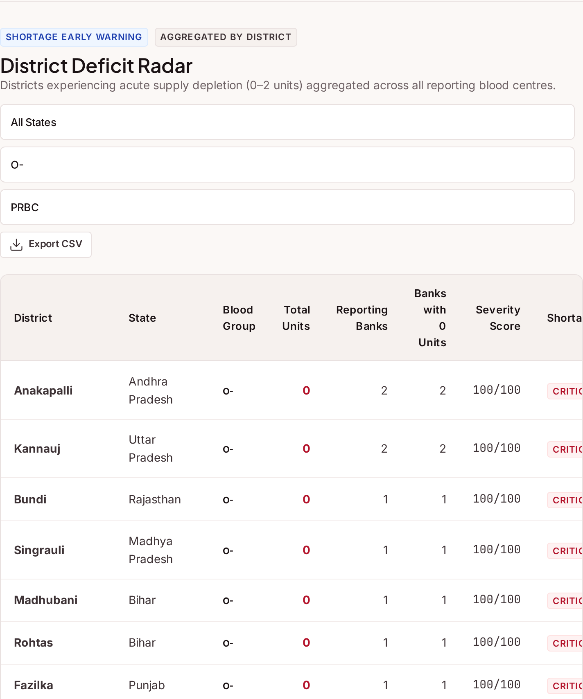
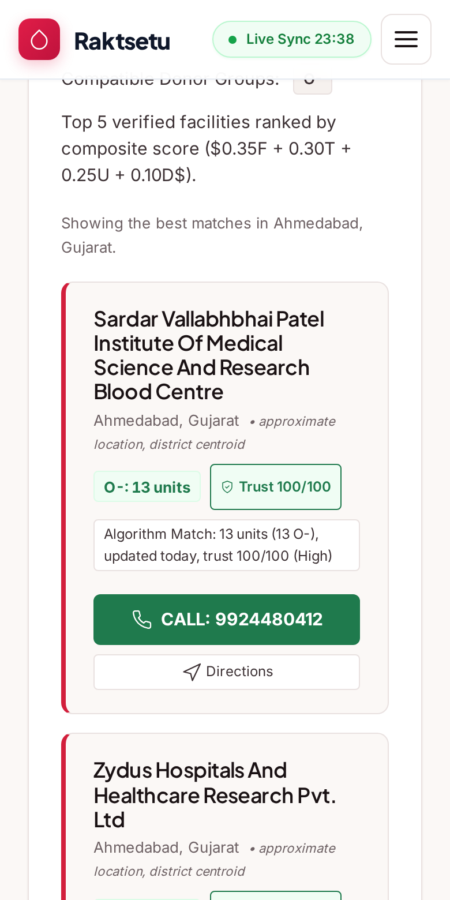
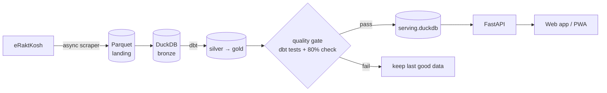
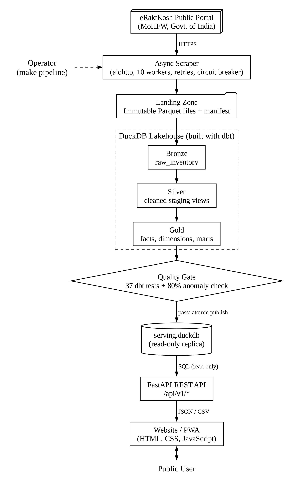
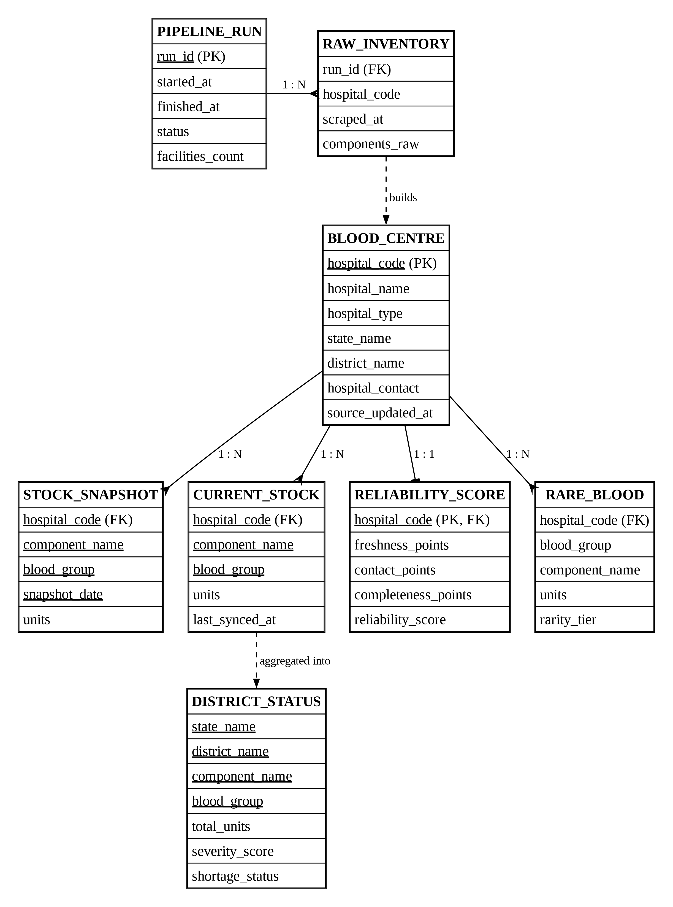

<div align="center">

# 🩸 Raktsetu: Real-Time Blood Availability Finder

**Find compatible blood across India in seconds, with how fresh and how reliable each listing is.**

*Academic data engineering project*

[](pyproject.toml)
[](https://duckdb.org)
[](dbt/)
[](src/bloodlake/api/main.py)
[](tests/)
[](tests/e2e/)
[](LICENSE)


</div>

> [!IMPORTANT]
> Uses public data from **eRaktKosh** (MoHFW, Govt. of India). This is an academic project, **not an official
> government service**. Compatibility hints follow NBTC India / WHO guidance and are **not medical advice**.
> Always call the blood bank before travelling.

---

## 📌 The problem

In an emergency, families phone blood bank after blood bank. The data exists on eRaktKosh, but:
- you search **one district at a time**;
- it doesn't show **compatible groups** (an O- patient can only receive O- red cells);
- it doesn't warn you when a bank **hasn't updated for weeks**.

**Raktsetu** collects stock from **4,716 blood banks in 701 districts** every 6 hours, checks its quality,
and serves it through a fast, mobile-friendly web app that also works offline.

---

## ✨ Features

| | |
|---|---|
| 🚑 **Emergency Mode**: shows only compatible donor groups (including plasma and Bombay rules), ranks banks by freshness, trust, units and distance, and explains *why* each one is ranked there |  |
| 🔎 **Blood Finder**: filter by state, district, group and component; sort by freshness, units, trust or distance; filters are kept in the URL so you can share a search |  |
| 📍 **Map + Near Me**: every bank on a map; GPS search widens from 50 → 150 → 400 km until it finds stock |  |
| ⭐ **Trust score (0–100)**: freshness (50) + valid phone (25) + component coverage (25) |  |
| 📈 **Stock trend** per bank, from real snapshots only (no invented history) |  |
| ⚠️ **District shortages + Rare Blood Radar** (Rh-negative and Bombay), with Excel-safe **CSV export** |  |

Also included: a donor eligibility checker, a data health panel, an installable **PWA** with offline mode, and a responsive layout from 360 px phones up.

<div align="center">
 &nbsp;
 &nbsp;

</div>

---

## 🏗️ How it works



1. **Collect:** a polite async scraper (`aiohttp`, at most 10 requests at once, retries, circuit breaker) fetches every district.
2. **Land:** raw answers are saved as Parquet files that are never changed, each with a SHA-256 hash.
3. **Transform:** **dbt** turns raw data into cleaned (silver) and ready-to-use (gold) DuckDB tables: current stock, history, trust score, shortages and rare blood.
4. **Gate:** if 37 data tests fail or the number of banks drops below 80% of the last run, nothing is published.
5. **Publish:** the database is copied to `serving.duckdb` in one atomic step.
6. **Serve:** FastAPI answers JSON; a plain HTML/CSS/JS PWA shows it.

<details>
<summary>📐 Architecture and ER diagrams</summary>

 
</details>

**Tech stack:** Python 3.12 · uv · aiohttp · PyArrow/Parquet · DuckDB · dbt-duckdb · FastAPI · Pydantic · Leaflet · Chart.js · Service Worker · pytest · Playwright · ruff · Docker · GitHub Actions

---

## 🚀 Quick start

```bash
git clone https://github.com/radhey803/eraktkosh-blood-lakehouse.git
cd eraktkosh-blood-lakehouse
make install          # uv sync
make pipeline         # scrape eRaktKosh → build the lakehouse (about 5–15 min, needs internet)
make run              # http://localhost:8000   ·   API docs: http://localhost:8000/docs
```

| Command | What it does |
|---|---|
| `make scrape / load / transform / gate / publish` | Run one pipeline step at a time |
| `make status` | Recent pipeline runs |
| `make test` · `make lint` · `make dbt-test` | Tests and code checks |
| `uv run python tests/e2e/e2e_check.py` | 146-check browser test (with `make run` running) |

Full setup for Linux, macOS and Windows, with fixes for common errors: **[docs/guide/02_INSTALLATION.md](docs/guide/02_INSTALLATION.md)**

---

## 📘 Documentation

A complete beginner-friendly guide (17 chapters) is in **[docs/guide/](docs/guide/00_START_HERE.md)**:

| | |
|---|---|
| [Start here](docs/guide/00_START_HERE.md) · [Concepts](docs/guide/01_CONCEPTS_FOR_BEGINNERS.md) · [Install](docs/guide/02_INSTALLATION.md) · [User guide](docs/guide/03_USER_GUIDE.md) | Getting started |
| [Architecture](docs/guide/04_ARCHITECTURE.md) · [Pipeline](docs/guide/05_DATA_PIPELINE.md) · [dbt](docs/guide/06_DBT_MODELS.md) · [Database](docs/guide/07_DATABASE.md) | Data engineering |
| [API](docs/guide/08_BACKEND_API.md) · [Domain logic](docs/guide/09_DOMAIN_LOGIC.md) · [Frontend](docs/guide/10_FRONTEND.md) | App |
| [Testing](docs/guide/11_TESTING.md) · [Deployment](docs/guide/12_DEPLOYMENT_AND_OPERATIONS.md) · [Troubleshooting](docs/guide/13_TROUBLESHOOTING.md) | Operations |
| [Build it yourself](docs/guide/14_BUILD_IT_YOURSELF.md) · [Tech stack](docs/guide/15_TECH_STACK_REFERENCE.md) · [Glossary & FAQ](docs/guide/16_GLOSSARY_AND_FAQ.md) | Learning |

Also: [design decisions (ADRs)](docs/adr/)

---

## 📂 Repository layout

```text
src/bloodlake/      scraper, pipeline CLI, API, medical rules, scoring, geo, CSV export
dbt/                silver + gold SQL models, tests, blood-group macro
web/                index.html, app.js, style.css, service worker, manifest
data/               district metadata, medical rules, district coordinates
tests/              unit, integration (fixture DB), e2e (Playwright)
docs/               guide, ADRs, diagrams, screenshots
```

---

## ⚠️ Limitations

- A snapshot every 6 hours, not live stock; accuracy depends on blood banks updating eRaktKosh.
- Map locations are district centres, not exact hospital addresses.
- "Near me" needs HTTPS or localhost; the interface is English only.

## 📄 License

[Apache 2.0](LICENSE). Blood stock data belongs to eRaktKosh (MoHFW, Govt. of India).
