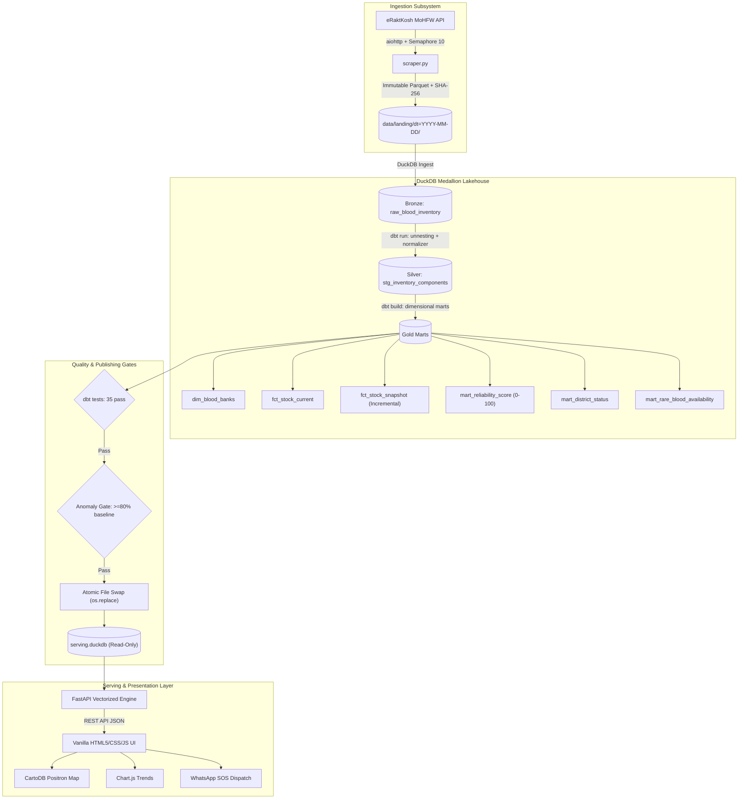
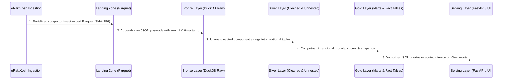
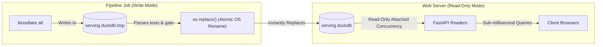

# eRaktKosh Blood Lakehouse: Technical Architecture Specification & ADRs

**Academic Context:** Academic Project Mini Project (800 Marks)  
**Context:** Academic Research Project  
**System Type:** Real-Time Medallion Analytical Blood Lakehouse  

---

## 1. System Architecture Overview

The **eRaktKosh Blood Lakehouse** is an end-to-end modern data engineering system designed to ingest, clean, model, and serve real-time blood availability intelligence across all 781 districts in India (~4,680 blood centers).



---

## 2. Medallion Data Progression

The pipeline organizes data into three distinct architectural layers:



1. **Landing Zone (`data/landing/`):**
   - Stores raw scrape outputs as partitioned, immutable Parquet files.
   - Preserves exact source data for auditability, disaster recovery, and historical backfills.
   - Eliminates CSV parsing corruptions caused by unquoted commas in facility addresses.

2. **Bronze Layer (`main_bronze.raw_blood_inventory`):**
   - Append-only raw DuckDB table recording `run_id`, `scraped_at`, state, district, and raw JSON strings.
   - Contains zero business transformations.

3. **Silver Layer (`main_silver`):**
   - `stg_blood_banks`: Deduplicated facility dimension with cleaned names, phone numbers, and timestamps.
   - `stg_inventory_components`: Relational unnesting of component strings into one record per `(facility, component, blood_group, units)`.
   - Normalization: Invokes strict normalizer regex macro ensuring `B+` never matches `AB+` and `O+` never matches `Bombay (Oh+)`.

4. **Gold Layer (`main_gold`):**
   - `dim_blood_banks`: Unified facility master dimension.
   - `fct_stock_current`: Current live stock per facility, component, and blood group.
   - `fct_stock_snapshot`: Incremental append-only snapshots recording daily stock changes.
   - `mart_reliability_score`: Computed facility trustworthiness score (0–100).
   - `mart_district_status`: District-level inventory and acute deficit monitoring.
   - `mart_rare_blood_availability`: Real-time radar for Bombay blood group (`Oh+`, `Oh-`) and universal negative (`O-`).

---

## 3. Serving & Concurrency Architecture

A common failure mode with embedded databases like DuckDB is concurrency contention between analytical write jobs and web server read requests. The lakehouse resolves this cleanly via an **atomic swap strategy**:



- Web requests query `serving.duckdb` in **strictly read-only mode** (`read_only=True`).
- DuckDB allows unlimited concurrent read connections.
- Pipeline updates are built into a temporary file (`serving.duckdb.tmp`) and swapped atomically using `os.replace()`.
- Result: **Zero read downtime and zero lock contention.**

---

## 4. Architecture Decision Records (ADRs)

### ADR-001: Choice of Embedded Columnar OLAP (DuckDB) over Traditional RDBMS (PostgreSQL/MySQL)

- **Status:** Accepted
- **Context:** The system extracts ~4,680 facilities with dozens of component rows each (~60,000 inventory items per run). The application requires aggregating inventory across 781 districts, calculating reliability scores, and executing multi-attribute filters in real time.
- **Decision:** Use **DuckDB** as the embedded analytical lakehouse engine.
- **Justification:**
  1. *Vectorized Execution:* DuckDB processes columns in vectorized batches using SIMD instructions, outperforming traditional row-based engines (PostgreSQL) by 10x–50x for analytical aggregations.
  2. *Zero Operational Overhead:* DuckDB is in-process and serverless. No separate background daemon, port management, connection poolers (PgBouncer), or credential rotation are required.
  3. *Native Parquet Integration:* DuckDB can directly query and export compressed Parquet files with zero serialization penalty.
  4. *Right-Sized:* A complete nationwide snapshot consumes only ~15 MB, making embedded columnar storage ideal for an MCA capstone project.
- **Consequences:** DuckDB supports multiple readers but only one active writer. Mitigated by building writes into `.tmp` databases and executing atomic filesystem swaps.

---

### ADR-002: Analytics Engineering with dbt Core over Ad-Hoc Python Scripts

- **Status:** Accepted
- **Context:** Transforming raw semi-structured JSON strings into clean relational marts involves unnesting, deduplication, regex normalization, and quality validation. Writing custom Python SQL strings leads to spaghetti code, lack of testability, and undocumented schema drift.
- **Decision:** Adopt **dbt Core** (`dbt-duckdb`) for all transformations from Bronze to Gold.
- **Justification:**
  1. *Modular SQL & Jinja:* Allows complex transformation logic (such as the strict blood group normalizer) to be maintained as reusable macros.
  2. *Built-in Testing:* dbt provides automated schema tests (`unique`, `not_null`, `accepted_values`) executed prior to publication.
  3. *Self-Documenting:* Generates visual dependency graphs (DAG) and relational data catalogs (`dbt docs generate`).
  4. *Academic Pedagogy:* Demonstrates state-of-the-art analytics engineering practices taught in modern data architecture courses.
- **Consequences:** Introduces a dbt compilation step into the pipeline execution. Mitigated by `dbt-duckdb` executing all 12 models and 35 tests in under 4 seconds.

---

### ADR-003: Adoption of the Medallion Lakehouse Architecture

- **Status:** Accepted
- **Context:** Raw healthcare data is frequently incomplete, unstructured, or noisy. Ingesting directly into reporting tables creates fragile dependencies where errors propagate unchecked.
- **Decision:** Implement the three-tier **Medallion Architecture** (Bronze &rarr; Silver &rarr; Gold).
- **Justification:**
  1. *Bronze (Raw):* Preserves raw extracted strings verbatim. If downstream parsing logic evolves, raw data can be reprocessed without re-scraping upstream servers.
  2. *Silver (Cleansed):* Unnests components into clean 3NF relational tuples with clinical taxonomy validation.
  3. *Gold (Business Marts):* Star-schema dimensional tables optimized for dashboard consumption (pre-aggregated reliability scores, district deficit rankings).
- **Consequences:** Modest storage overhead (~15 MB per run). Greatly compensated by debuggability and data lineage transparency.

---

### ADR-004: Choice of FastAPI over Django / Flask

- **Status:** Accepted
- **Context:** The backend must serve concurrent client search requests, stream analytical aggregates, and provide self-documenting API specifications for external evaluator inspection.
- **Decision:** Use **FastAPI** on Uvicorn ASGI.
- **Justification:**
  1. *Performance:* Built on Starlette and Pydantic, FastAPI is among the fastest Python web frameworks available.
  2. *Automatic OpenAPI / Swagger:* Evaluators and viva examiners can test all endpoints directly at `/docs` with interactive request builders.
  3. *Strict Typing with Pydantic:* Validates all inputs and outputs against schema models, eliminating runtime type bugs.
  4. *Async Support:* Seamlessly integrates with Python asynchronous runtime.
- **Consequences:** Requires explicit configuration of CORS and static asset mounting. Configured cleanly in `src/bloodlake/api/main.py`.

---

### ADR-005: Choice of Vanilla HTML5/CSS3/JS over Modern Frontend Frameworks (React/Next.js/Tailwind)

- **Status:** Accepted
- **Context:** The user interface must load instantly, display complex time-series charts and interactive maps, function offline during college viva presentations, and avoid brittle build-step failures.
- **Decision:** Handcraft the presentation layer using **Vanilla HTML5, Vanilla CSS3, and Vanilla JavaScript**.
- **Justification:**
  1. *Zero Build Step:* Eliminates `node_modules`, Webpack, Babel, Vite, and npm dependency vulnerabilities. Evaluators can clone the repo and run it immediately with Python alone.
  2. *Performance & Restraint:* Eliminates heavy client-side JavaScript bundles. Initial page load is < 100 KB and renders in under 200 ms.
  3. *Maximum Design Control:* Enables exact execution of the clinical red-and-white theme (`#FBF8F6` canvas, `#D21F3C` primary, hairline borders, zero emojis) without battling framework CSS resets.
  4. *Reliability During Viva:* Zero risk of broken client-side hydration or node environment mismatch during live demonstration.
- **Consequences:** Requires manual DOM manipulation for state updates. Managed cleanly through modular functions in `web/js/app.js`.

---

### ADR-006: Choice of GitHub Actions & System Cron over Apache Airflow

- **Status:** Accepted
- **Context:** Automated periodic execution of the pipeline is required to refresh national blood inventory. A workflow orchestrator is needed.
- **Decision:** Use **GitHub Actions Scheduled Workflows** (cron: every 6 hours) or standard **system cron** instead of hosting an Apache Airflow cluster.
- **Justification:**
  1. *Right-Sized Architecture:* The entire nationwide pipeline executes in ~26 seconds of network I/O and ~4 seconds of dbt transformations. Deploying Airflow (Scheduler, Webserver, Postgres metadata database, Redis broker, Celery workers) would consume 2–4 GB of RAM merely to run a 30-second job every 6 hours.
  2. *Operational Simplicity:* Airflow represents an over-engineered failure point for an MCA mini project. GitHub Actions runs natively in the cloud with zero hosting cost and automated run history.
  3. *Portability:* The CLI (`bloodlake all`) can be triggered from any single-line cron job:
     ```cron
     0 */6 * * * cd /path/to/project && uv run bloodlake all >> /var/log/bloodlake.log 2>&1
     ```
- **Consequences:** Does not have Airflow's DAG visualizer UI. Mitigated by `pipeline_runs` logging table and dbt documentation lineage graphs.
