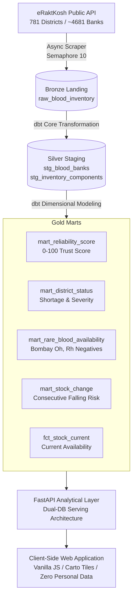

# eRaktKosh Blood Lakehouse: Real-Use-Case Features Guide

> **Project Story:**
> *"eRaktKosh shows blood stock like a phone book. My system turns it into a decision tool: where to go, how much to trust the listing, what is running low, and how it changed over time."*

---

## Architecture Overview of Decision-Tool Features

---

## 1. Trust Score (0-100) per Blood Bank

### Problem Solved
Government portals list facilities that may not have updated their records in months or lack a reachable telephone contact. Patients frequently travel across cities only to find closed or outdated facilities.

### Realistic Usage Scenario
A family in rural Anand district searches for A+ blood. They see two banks: Bank A lists 15 units updated 2 hours ago with an active landline; Bank B lists 20 units updated 28 days ago without a telephone number. Bank A has a **Trust Score of 95 (High)** while Bank B has a **Trust Score of 25 (Low)** with a warning: *"Low reliability, call to confirm before travelling."* The family avoids wasting critical hours visiting Bank B.

### How It Works
Calculated in dbt model `mart_reliability_score.sql` and Python module `src/bloodlake/scoring.py` across three verified pillars (Total: 100 points):

$$\text{Trust Score} = \text{Freshness (50 pts)} + \text{Valid Contact (25 pts)} + \text{Component Completeness (25 pts)}$$

1. **Freshness (50 points maximum):**
   - Updated $< 24$ hours: **50 points**
   - Updated $< 3$ days ($24\text{h} - 72\text{h}$): **35 points**
   - Updated $< 7$ days ($3\text{d} - 7\text{d}$): **20 points**
   - Updated $< 14$ days ($7\text{d} - 14\text{d}$): **8 points**
   - Updated $\ge 14$ days or unknown: **0 points**

2. **Valid Contact (25 points):**
   - Valid phone format check (cleaned digit length $\ge 8$ digits, not blank/dashes/dummies): **25 points**; else **0 points**.

3. **Component Completeness (25 points):**
   - $\ge 3$ distinct blood components cataloged (e.g., Whole Blood, PRBC, FFP, Platelets): **25 points**
   - 1 or 2 components listed: **15 points**
   - 0 components: **0 points**

- **Tiers & Badges:**
  - **High ($\ge 75$):** Green badge, recommended for immediate contact.
  - **Medium ($40 - 74$):** Amber badge, verify via telephone prior to dispatch.
  - **Low ($< 40$):** Crimson badge with explicit warning callout: *"Low reliability, call to confirm before travelling."*

### Data Dependencies
- `stg_blood_banks.last_updated`: Parsed timestamp from portal metadata.
- `stg_blood_banks.contact_phone`: Standardized phone number string.
- `stg_inventory_components.component_name`: Grouping of components per hospital.

### Limitations
A high score reflects reporting discipline and active digital record-keeping, but cannot physically guarantee that units were not reserved for trauma surgery within the last 30 minutes.

---

## 2. Smart Emergency Mode & Compatibility Matrix

### Problem Solved
In trauma and acute hemorrhage emergencies, non-medical attendants search only for the patient's identical blood group (e.g., searching strictly for $B+$ and despairing when zero is found, unaware that $O+$ and $O-$ red cells are compatible donors).

### Realistic Usage Scenario
An emergency room in Vadodara admits an $AB+$ hemorrhage patient. The hospital blood bank is out of $AB+$ PRBC. The attendant activates **Emergency Mode**, selecting $AB+$ patient group and PRBC. The system resolves all compatible donor groups ($O-, O+, A-, A+, B-, B+, AB-, AB+$), aggregates units across nearby facilities, ranks the top 5 facilities using an audited formula, and produces a one-click dispatch call list.

### How It Works
- **Medical Compatibility Matrix:** Sourced strictly from official National Blood Transfusion Council (NBTC) India and WHO guidelines stored in `data/medical_rules.json`.
- **Special Phenotype Rules:**
  - $O-$: Strictly compatible only with $O-$ donor cells.
  - Bombay Phenotype ($Oh+$ / $Oh-$): Lacks the H antigen; completely incompatible with all ABO groups. Can receive blood *only* from another verified Bombay donor.
- **Clinical Warning Banners:** Automatically displayed when the patient has Rh-negative or Bombay phenotypes, with source attribution.
- **Emergency Ranking Formula ($0 - 100$ Index):**
  $$\text{Rank Score} = 0.35 \times F + 0.30 \times T + 0.25 \times U + 0.10 \times D$$
  - $F$: Freshness points normalized ($0 - 100$).
  - $T$: Reliability trust score ($0 - 100$).
  - $U$: Available unit volume ($\min(100, \text{units} \times 5)$).
  - $D$: Distance score ($100 - \min(100, \text{distance\_km} \times 2)$).
- **Endpoint:** `GET /api/v1/emergency` returns the top 5 facilities along with a plain-language explanation (`why_ranked_here`, e.g., *"18 units available, updated 2h ago, trust 92, approx. 14 km away"*).

### Data Dependencies
- `data/medical_rules.json`: Canonical rules file with official source citations.
- `fct_stock_current`: Current unit counts per hospital and component.
- `mart_reliability_score`: Real-time trust metrics.

### Limitations
Emergency red cell compatibility guidance does not substitute for cross-matching and bedside Coombs testing. Attendants must call the facility before departing.

---

## 3. Nearest Bank by Distance & Geocoding Service

### Problem Solved
eRaktKosh only filters by administrative state and district, leaving users unable to determine which hospital is physically closest to them, especially when living near district boundaries.

### Realistic Usage Scenario
A patient at the border of Anand and Kheda districts requires platelets. Sorting by distance reveals a tertiary care hospital in Nadiad (Kheda) only 12 km away, whereas the Anand district hospital is 38 km away.

### How It Works
1. **User Geolocation:** Client-side HTML5 Geolocation API (`navigator.geolocation`) initiates only upon explicit user button click ("Near Me"). Coordinates are never stored on the server or logged.
2. **Nominatim Geocoding Cache:**
   - Permanent cache table: `main_gold.geocode_cache` (`hospital_code`, `lat`, `lng`, `precision`, `cached_at`).
   - Adheres to OpenStreetMap Nominatim Usage Policy: rate-limited to maximum 1 request per second with a unique User-Agent header (`eRaktKosh-Academic-Lakehouse/1.0`).
   - Fallback hierarchy with precision tracking:
     - `exact`: Exact facility rooftop geocode.
     - `street`: Street-level match.
     - `district_centroid`: District administrative center with deterministic offset based on hash of hospital code (prevents map pin stacking).
     - `failed`: National centroid fallback.
3. **Haversine Distance Metric in SQL:**
   $$d = 2R \arcsin\left(\sqrt{\sin^2\left(\frac{\Delta \phi}{2}\right) + \cos(\phi_1)\cos(\phi_2)\sin^2\left(\frac{\Delta \lambda}{2}\right)}\right)$$
   Where $R = 6371\text{ km}$. Displayed with honest labeling: *"approx. X km"* and marker styling distinguishing exact vs. district centroid coordinates.

### Data Dependencies
- `geocode_cache`: DuckDB permanent table.
- District centroids dictionary: 781 verified district coordinates.

### Limitations
Haversine computes great-circle straight-line distance; it does not account for road traffic, bridge closures, or geographic detours.

---

## 4. District Shortage Ranking & Rare Blood Radar

### Problem Solved
State health authorities and hospital networks cannot easily identify which districts are experiencing severe blood component deficits or where ultra-rare units (like Bombay phenotype or AB-) are currently stocked.

### Realistic Usage Scenario
During dengue season, platelet demand surges. The state blood transfusion council opens the Shortage Ranking view to identify districts where $>50\%$ of reporting blood banks have zero platelets. They immediately re-route surplus voluntary donation camp drives from surplus districts to those in acute shortage.

### How It Works
- **dbt Model `mart_district_status.sql`:** Aggregates by `state_name`, `district_name`, `component_name`, and `blood_group`:
  - `reporting_banks`: Count of facilities reporting in that district.
  - `banks_with_zero`: Count of facilities with zero stock.
  - `total_units`: Sum of available units.
  - `severity_score`: $(\text{banks\_with\_zero} / \text{reporting\_banks}) \times 100$.
  - `shortage_status`: `CRITICAL` ($>60\%$), `WARNING` ($30-60\%$), or `ADEQUATE` ($<30\%$).
- **dbt Model `mart_rare_blood_availability.sql`:** Filters for Bombay phenotypes ($Oh+$, $Oh-$) and Rh-negative blood groups across the country, showing units, freshness, and trust score.
- **Reporting Clarity:** The UI prominently shows *"reporting banks"* next to every zero count and explains that a zero may indicate non-reporting rather than total regional absence.

### Data Dependencies
- `main_gold.fct_stock_current` joined with `main_gold.dim_blood_banks`.

### Limitations
Districts with only 1 registered blood bank may oscillate between 0% and 100% severity whenever a single unit is checked out.

---

## 5. Stock History, Trend & Rule-Based Risk Flags

### Problem Solved
Point-in-time stock counts do not tell users if a blood bank's inventory is actively rising from a blood drive or rapidly depleting toward stockout. Synthetic data generation undermines clinical trust.

### Realistic Usage Scenario
A blood bank coordinator reviews B+ PRBC stock. While current stock shows 8 units, the 7-day trend reflects consecutive drops from 32 $\rightarrow$ 21 $\rightarrow$ 14 $\rightarrow$ 8 units across consecutive snapshots. The system raises a **"Falling"** risk flag, prompting a mobile donation drive before a complete stockout occurs.

### How It Works
- **Zero-Fake-Data Guarantee:** If fewer than 2 real snapshots exist, the system honestly displays: *"Trend data builds up daily. First genuine lakehouse snapshot recorded on [Date]. Needs at least 2 real snapshots for trajectory."*
- **dbt Model `mart_stock_change.sql`:**
  - Evaluates lag deltas: `delta_vs_previous` and `delta_7d`.
  - **Rule-Based Risk Flag (`Falling`):** Raised when stock exhibits a monotonic decrease across $\ge 3$ consecutive snapshot intervals ($\ge 4$ snapshots required).
  - **Anomaly Flag (`SUDDEN_DROP_TO_ZERO`):** Raised when inventory drops from $\ge 10$ units directly to 0 in a single snapshot interval.
  - No synthetic interpolation, opaque machine learning, or black-box forecasting; all rules are stated in plain language.

### Data Dependencies
- `main_gold.fct_stock_snapshot`: Append-only daily lakehouse partition.

### Limitations
Requires historical pipeline runs across multiple calendar days to populate trend charts.

---

## 6. Client-Side Donor Help & Gap Calculator

### Problem Solved
Volunteers arrive at blood donation centers only to be turned away due to simple disqualifications (e.g., donating 45 days ago, weighing under 45 kg, or minor hemoglobin deficiency). Additionally, users fear submitting health questionnaires online due to privacy concerns.

### Realistic Usage Scenario
A student wants to donate blood at a college camp. She uses the browser tool to enter her age (19), weight (48 kg), gender (Female), and last donation date (60 days ago). The tool instantly calculates that for female donors in India, the mandated interval is 120 days (NBTC 2020), informing her: *"Eligible in 60 days (approx. December 14)."* It also lists low-stock blood banks in her district where her blood group is running low.

### How It Works
1. **Zero Data Transmission:** The entire eligibility questionnaire and gap calculator execute 100% client-side in vanilla JavaScript (`web/js/app.js`). No form inputs, dates, weights, or answers are sent over HTTP or stored in cookies/localStorage.
2. **Official Medical Sourcing (`data/medical_rules.json`):**
   - Minimum Age: 18 years, Maximum Age: 65 years.
   - Minimum Weight: 45 kg (for 350 mL whole blood collection).
   - Minimum Hemoglobin: 12.5 g/dL.
   - Mandated Donation Intervals (NBTC Guidelines 2020):
     - **Male:** 90 days (3 months).
     - **Female:** 120 days (4 months).
3. **Where to Donate Suggestions:** Reads current low-stock banks from `mart_district_status` with a prominent disclaimer: *"This is an automated inventory suggestion based on current shortages, not an official emergency appeal from the blood bank."*

### Data Dependencies
- Client-side execution of rules from `data/medical_rules.json`.

### Limitations
Automated self-screening cannot replace the mandatory pre-donation confidential interview, vital signs check (blood pressure, pulse), and copper sulfate hemoglobin prick performed on-site by a registered medical officer.

---

## 7. Sharing & Standardized CSV Export

### Problem Solved
Attendants in hospital corridors need to send blood bank details over WhatsApp to family members, while researchers and district administrators need offline spreadsheets with verified government attribution.

### Realistic Usage Scenario
A relative coordinates blood pickup from another city. Clicking **"Copy Dispatch Card"** formats a plain-text WhatsApp-ready message with hospital name, blood group, units, phone number, Google Maps link, and the exact data timestamp. Meanwhile, an academic researcher downloads the statewide shortage summary via **"Export CSV"** for analysis in Microsoft Excel.

### How It Works
1. **URL State Synchronization:** All search filters (`state`, `district`, `blood_group`, `component`, `page`) are continuously serialized to browser URL query parameters, enabling instant link sharing.
2. **WhatsApp Dispatch Card:** Generates a structured clipboard snippet with contact and verification timestamps.
3. **Excel-Compatible CSV Export:**
   - Endpoints: `GET /api/v1/export/availability.csv` and `GET /api/v1/export/shortages.csv`.
   - Formatted with UTF-8 Byte Order Mark (`\ufeff`) so Microsoft Excel correctly displays Hindi/Gujarati scripts and non-ASCII facility names.
   - Includes mandatory MoHFW data source attribution and disclaimer rows at the top of the file.

### Data Dependencies
- Parameterized streaming from DuckDB gold marts.

### Limitations
Generated links depend on the recipient having network access to the web server instance.

---

## 8. Data Quality, Observability & Publish Gate

### Problem Solved
Silent scraping failures or partial network drops can corrupt lakehouse data or publish empty datasets to users without operators noticing.

### Realistic Usage Scenario
During a nightly scraper run, the upstream government portal returns HTTP 429 on 50% of requests. Rather than overwriting the live database with a broken subset, the **Publish Gate** halts the deployment, preserves the last healthy `serving.duckdb`, and flags the pipeline status as `FAILED` on the Data Health dashboard.

### How It Works
1. **Observability Mart & Table (`main_gold.pipeline_runs`):**
   - Automatically tracks every run: `run_id`, `started_at`, `finished_at`, `status`, `rows_scraped`, `tests_passed`, and `error`.
2. **Stale Data Banner:**
   - If the last successful sync timestamp is older than 12 hours, a site-wide warning banner alerts the user: *"Data was last synced [X] hours ago. Hospital availability may have changed."*
3. **Dual-Database Publish Gate:**
   - Scrape and dbt transformation execute on `blood_warehouse.duckdb`.
   - Gate Condition: If dbt test execution fails OR total scraped facilities drop below $80\%$ of the previous run count, publication is aborted.
   - Atomic replacement: Only upon complete validation is the warehouse atomically published to `serving.duckdb`.

### Data Dependencies
- `pipeline_runs` DuckDB metadata table.

### Limitations
The publish gate prevents corrupted publishes, but cannot restore upstream connectivity if the government source portal experiences prolonged downtime.

---

## 9. Languages & Inclusive Accessibility (WCAG AA & PWA)

### Problem Solved
Patients and attendants in distress in India come from diverse linguistic backgrounds and may browse under low network conditions on mobile phones.

### Realistic Usage Scenario
A rural family in Kheda navigates the portal in Gujarati on an Android smartphone with poor 2G/3G connectivity. The application loads quickly as an installable Progressive Web App (PWA), persists cached hospital cards, and maintains high-contrast typography in sunlight.

### How It Works
- **Trilingual Dictionary:** English, Hindi (हिन्दी), and Gujarati (ગુજરાતી) supported via client-side dictionary in `web/js/translations.js`. User language preference is remembered in `localStorage`.
- **Progressive Web App (PWA):**
  - Web App Manifest: `web/manifest.json`.
  - Service Worker: `web/sw.js` precaches core app shell (HTML, CSS, JS, SVG sprites) and caches last-loaded search results with an offline fallback indicator: *"Offline mode: displaying cached results from [timestamp]."*
- **WCAG AA Compliance:**
  - High contrast ratio ($\ge 4.5:1$) across warm canvas `#FBF8F6` and deep ink `#1A1214`.
  - 44px minimum touch targets for all interactive buttons.
  - Full keyboard accessibility with visible focus rings (`:focus-visible`).
  - Screen-reader announcements via `aria-live` containers for dynamic search results.

### Data Dependencies
- Localized JSON translation dictionary.

### Limitations
Dynamic hospital names and addresses provided by the government portal remain in their original source language (primarily English or Romanized script).

---

## 10. Design System & Editorial Aesthetics

### Problem Solved
Clinical tools often look like generic dashboard templates with garish neon colors, cartoonish emojis, and confusing layouts, eroding trust in life-critical moments.

### Realistic Usage Scenario
A doctor or attendant opens the portal and immediately recognizes an institutional, authoritative, and calming environment that prioritizes scannable clinical data over marketing clutter.

### How It Works
- **Curated Medical Color Palette:**
  - Warm Off-White Canvas: `#FBF8F6` (surface `#FFFFFF`, card `#FFFFFF`).
  - Deep Ink Typography: `#1A1214`.
  - Primary Clinical Red: `#D21F3C` (blood accent, high contrast).
  - Muted Borders: `#E8E2DE` (hairline 1px).
- **Typography:**
  - Editorial Headings: Refined serif typography (`Instrument Serif`, `Georgia`, `serif`).
  - Clean Grotesk UI: `Plus Jakarta Sans`, `-apple-system`, `sans-serif`.
  - Tabular Numerals: `font-variant-numeric: tabular-nums` for all stock counts and distances.
- **Zero-Emoji Architecture:** All icons are rendered via a centralized inline SVG sprite (`web/index.html`), ensuring uniform scaling, consistent stroke weight, and zero emoji rendering discrepancies across platforms.
- **Status Integrity:** Every clinical state uses **icon + text** (e.g., green dot + "High", amber triangle + "Medium", red shield + "Low"), never relying on color alone for colorblind accessibility.

---

*Authored for eRaktKosh Blood Lakehouse Academic Project (Academic Project).*
