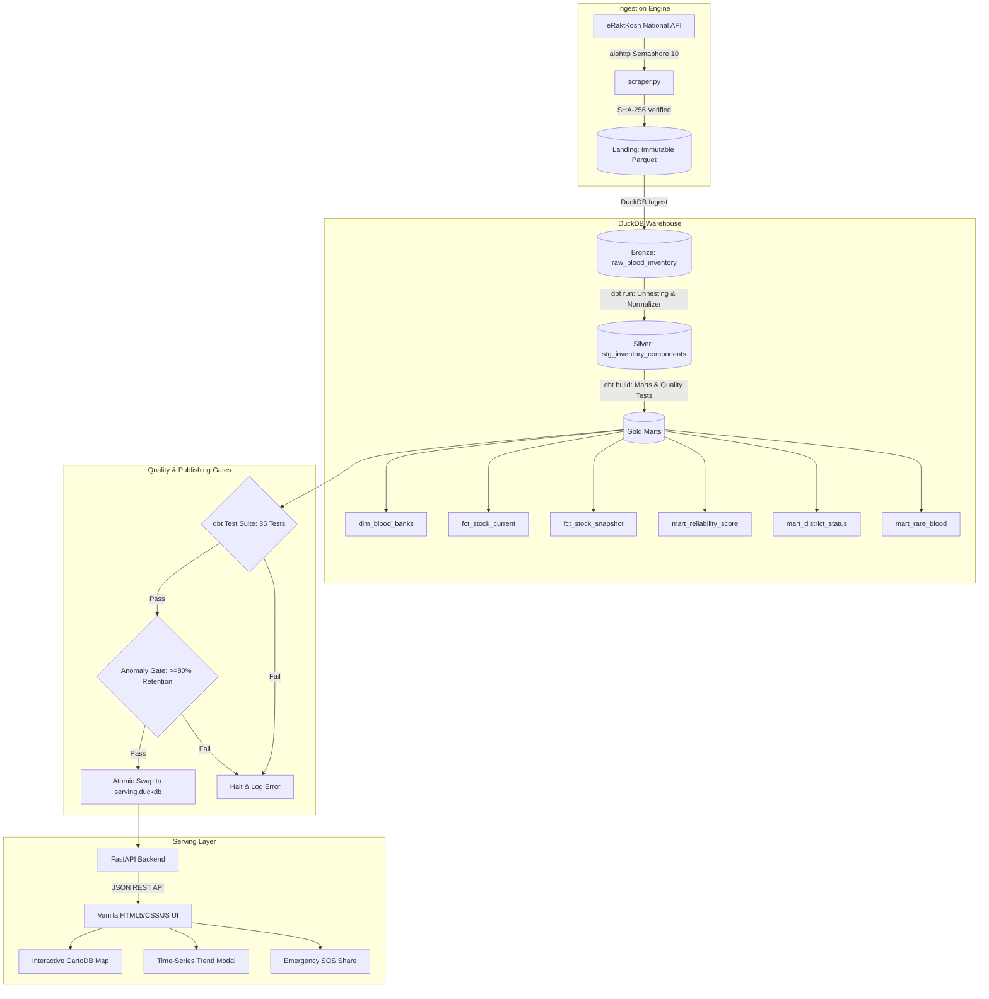
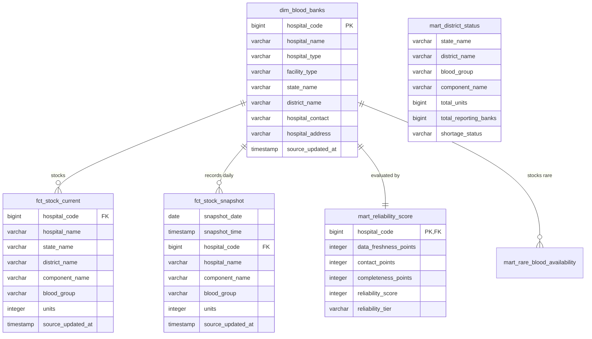
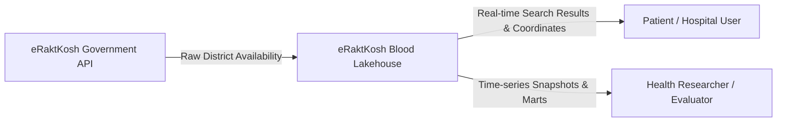
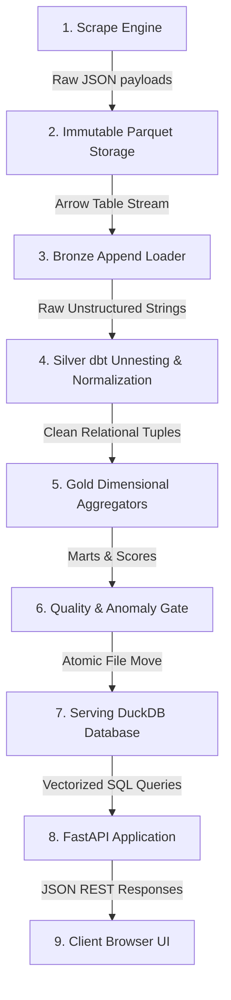
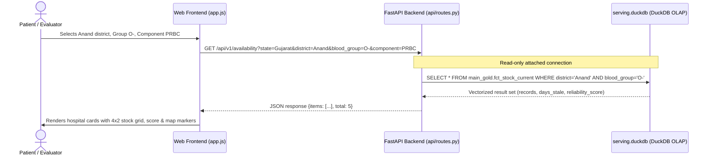
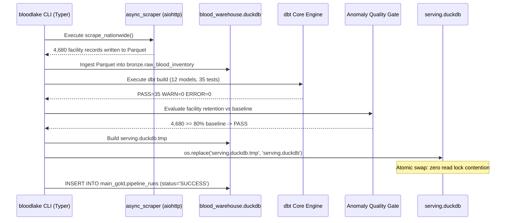

# eRaktKosh Blood Lakehouse: Real-Time Medallion Data Engineering & Emergency Blood Inventory Intelligence System

**Project Report Submitted in Partial Fulfillment of the Requirements for the Degree of**  
**Academic Project**  
**Department of Computer Applications**  
**Academic Research Project**

---

## Candidate & Guide Information
- **Student Name:** [Student Name]
- **Enrollment Number:** [Enrollment Number]
- **Degree Programme:** Academic Project
- **Course Title:** Mini Project (800 Marks)
- **Academic Year:** 2026–2027
- **Internal Project Guide:** [Internal Guide Name / Designation]
- **Institutional Department:** Faculty of Computer Science and Applications

---

## Executive Summary / Abstract

Timely access to safe, compatible blood products during surgical interventions, trauma emergencies, and chronic transfusion-dependent conditions (such as Thalassemia Major and Sickle Cell Anemia) remains a critical challenge in India. While the Ministry of Health & Family Welfare (MoHFW) operates the centralized **eRaktKosh** portal to collect blood bank inventory records, the upstream system functions as a point-in-time relational repository without historical trend tracking, data reliability metrics, geospatial intelligence, or automated supply deficit monitoring. Furthermore, users frequently encounter stale facility records where inventory has not been updated for weeks or months.

This project introduces the **eRaktKosh Blood Lakehouse**, a high-performance, open-access data engineering and analytical platform engineered specifically for national-scale blood inventory intelligence. Built upon an asynchronous Python extraction engine with polite concurrency throttles (`aiohttp` with `Semaphore(10)` and exponential backoff), the system queries all 781 districts across 36 Indian states and union territories (~4,680 registered facilities in ~26 seconds). 

The data architecture adheres to the **Medallion Lakehouse Paradigm**:
1. **Landing & Bronze Layer:** Writes immutable, timestamped Parquet snapshots with SHA-256 cryptographic verification, followed by append-only raw ingestion into DuckDB.
2. **Silver Layer (dbt Core):** Unnests nested component blobs into atomic relational records per `(facility, component, blood_group, units, source_updated_at)` and enforces a strict regex normalizer macro proving clinical isolation between standard phenotypes (`B+` vs. `AB+`) and rare variants (`O+` vs. Bombay `Oh+`).
3. **Gold Layer (Analytical Marts):** Constructs dimensional models (`dim_blood_banks`, `fct_stock_current`, `fct_stock_snapshot`), computes an algorithmic **Reliability Score (0–100)** incorporating data recency (50 pts), contact validity (25 pts), and component completeness (25 pts), and isolates rare blood availability (`mart_rare_blood_availability`) alongside district deficits (`mart_district_status`).

Serving is handled by an atomic blue/green deployment strategy into a read-only DuckDB instance served by **FastAPI** with structured SQL queries (zero fragile runtime regular expressions). The front-end delivers an accessible, clinical-grade interface utilizing Vanilla HTML5, CSS3, and JavaScript with CartoDB Positron maps, Chart.js time-series visualizations, and multilingual localization (English, Hindi, Gujarati). Crucially, the system enforces a strict **Zero Fake Data Policy**: time-series trajectories begin only from verified historical pipeline executions, presenting honest evaluation states when fewer than two consecutive snapshots exist.

---

## Chapter 1: Introduction

### 1.1 Context and Motivation
Blood transfusion services are an indispensable cornerstone of acute healthcare delivery. In India, annual blood collection requirements exceed 14.6 million units, yet healthcare providers face severe regional disparities, seasonal supply fluctuations, and localized deficits. 

Although government initiatives like the eRaktKosh digital platform mandate daily reporting from licensed blood centers, patients and medical teams searching for compatible blood components in emergency situations often confront incomplete information, lack of geographic proximity context, and outdated records. A data platform that continuously extracts, validates, normalizes, and historically tracks national blood stock metrics provides immense academic, clinical, and societal value.

### 1.2 Academic Significance
This project is formulated as an MCA Capstone Mini Project (800 Marks) to demonstrate end-to-end engineering rigor across:
- **Distributed Ingestion:** High-concurrency asynchronous HTTP harvesting with politeness guarantees.
- **Modern Data Lakehouse Architecture:** Medallion storage progression (Raw &rarr; Cleaned &rarr; Analytical Marts) using embedded columnar OLAP technology (**DuckDB**) and analytics engineering (**dbt Core**).
- **Relational Data Contracts:** Strict schema validation, accepted values, and referential integrity tests.
- **Real-Time Analytical API:** Microsecond-latency vectorized query execution via FastAPI.
- **Human-Centric User Interface:** Handcrafted, clinical UI with zero emojis, accessible semantic design, and honest map pin labeling.

---

## Chapter 2: Problem Statement & Literature Review

### 2.1 Problem Statement
The current digital blood ecosystem in India suffers from significant operational and analytical bottlenecks:
1. **Absence of Historical Depth:** Upstream repositories overwrite previous stock levels. Consequently, healthcare planners cannot observe depletion velocities, seasonal donation deficits, or multi-day replenishment trends.
2. **Lack of Data Trustworthiness Signals:** A facility showing 20 units of `O-` PRBC updated three months ago is presented alongside a facility updated 20 minutes ago, resulting in wasted emergency transit time.
3. **Fragile Semi-Structured Formats:** Upstream responses bundle component quantities in semi-structured dictionary strings (e.g., `'B+Ve: 12, AB-Ve: 2'`). Systems relying on loose application-level regular expressions frequently misattribute quantities (e.g., matching `AB+` when querying `B+`).
4. **Geospatial Opacity:** Users must navigate disjointed administrative drop-downs without an interactive map overview.
5. **Lack of Automated Early Warning Deficit Detection:** No automated intelligence aggregates district inventories to alert regional transfusion committees of impending acute deficits.

### 2.2 Literature and Existing System Study

| Dimension | Upstream eRaktKosh Portal | Typical Commercial Apps | eRaktKosh Blood Lakehouse (This Project) |
|---|---|---|---|
| **Data Architecture** | Monolithic OLTP Database | Proprietary Web Application | Modern Medallion Lakehouse (DuckDB + dbt) |
| **History Tracking** | Overwrite (Point-in-Time only) | Synthetic / Simulated data | Real Append-Only Snapshots (Zero Fake Data) |
| **Query Engine** | Standard SQL on OLTP tables | In-memory cache / MongoDB | Vectorized Columnar Engine (DuckDB OLAP) |
| **Data Reliability Score** | None (All records treated equally) | Basic user ratings | Algorithmic 0–100 Score (Recency, Contact, Stock) |
| **Blood Group Isolation** | Basic string pattern match | Application-level regex | Formal dbt SQL normalizer (`B+` &ne; `AB+`, `O+` &ne; `Oh+`) |
| **Rare Phenotype Radar** | Generic search dropdown | None | Dedicated Bombay (`Oh`) & `O-` national mart |
| **District Deficit Radar** | Not Available | Not Available | Automated aggregate deficit classification |
| **Source Politeness** | N/A (Origin) | Unregulated high-volume scraping | Concurrency Semaphore(10), Backoff, Identifiable Agent |
| **Map Pin Transparency** | Centroid presented as exact | Exact pin claimed | Honestly labeled: *"approximate, district level"* |

---

## Chapter 3: Project Objectives & Scope

### 3.1 Project Objectives
1. **Automated Polite Ingestion:** Implement an asynchronous harvesting engine capable of querying all 781 districts in under 30 seconds without overloading upstream servers.
2. **Immutable Storage:** Store raw scrape outputs in partitioned, immutable Parquet files with cryptographic SHA-256 checksums to eliminate CSV parsing corruptions.
3. **Medallion dbt Pipeline:** Engineer Bronze (raw), Silver (unnested component-level relational tables), and Gold (dimensional marts and analytical aggregates) models using dbt Core.
4. **Zero-Defect Phenotype Normalization:** Develop and unit-test a robust normalizer macro guaranteeing complete isolation between blood groups.
5. **Trustworthiness Scoring:** Create a 0–100 Facility Reliability Score model.
6. **Zero Fake Data Contract:** Enforce complete integrity in historical tracking; multi-day graphs reflect only genuine pipeline runs.
7. **Vectorized API Serving:** Build high-concurrency FastAPI analytical endpoints with parameterized queries, caching headers, and atomic blue/green database swapping.
8. **Clinical Front-End:** Develop an accessible, responsive web application (Vanilla HTML/CSS/JS) supporting Leaflet maps, time-series charts, and multilingual localization.

### 3.2 Scope and Explicit Exclusions
- **In Scope:** National facility indexing (~4,680 centres), emergency search, component filtering (PRBC, Whole Blood, Platelets, FFP, etc.), time-series trend tracking, district shortage radar, rare blood tracking, and data quality testing.
- **Explicit Out of Scope:** Commercial payment gateways, billing modules, user account management, monetized tiers, and physical blood dispatching. Under the *Drugs and Cosmetics Act, 1940*, commercial blood trading is prohibited in India; this platform functions exclusively as an academic data lakehouse and public health analytics system.

---

## Chapter 4: Feasibility Study & Requirements

### 4.1 Feasibility Analysis
- **Technical Feasibility:** Python 3.12, DuckDB, dbt Core, and FastAPI are open-source, highly mature technologies. DuckDB provides vectorized in-process OLAP execution without external server overhead, making it ideal for self-contained academic deployment.
- **Economic Feasibility:** The architecture incurs zero external database licensing fees. The complete pipeline executes efficiently on standard developer workstations (8 GB RAM, multi-core CPU) or low-cost cloud virtual machines.
- **Operational Feasibility:** Minimal operational maintenance is required due to automated CLI commands (`bloodlake all`) and scheduled GitHub Actions workflows.

### 4.2 Functional Requirements (FR)
- **FR-1 [Scrape]:** System must extract availability data across 781 districts with concurrency bound to 10 workers and minimum run intervals.
- **FR-2 [Ingest]:** Raw scrape payloads must be persisted to timestamped Parquet files and appended to the Bronze warehouse.
- **FR-3 [Transform]:** Semi-structured components must be unnested into one record per component-phenotype combination.
- **FR-4 [Score]:** Every facility must be evaluated on a 0–100 reliability scale.
- **FR-5 [Search]:** API must support multi-attribute filtering (State, District, Component, Blood Group, Minimum Units, Query) via pure SQL on Gold marts.
- **FR-6 [History]:** API must deliver daily stock trajectories from verified snapshot tables.
- **FR-7 [Anomaly Gate]:** Pipeline must reject builds where facility count drops below 80% of historical baselines.
- **FR-8 [Localization]:** UI must allow seamless switching between English, Hindi, and Gujarati.

### 4.3 Non-Functional Requirements (NFR)
- **NFR-1 [Performance]:** API response time for complex availability queries must remain &le; 25 ms.
- **NFR-2 [Reliability]:** Serving database swap must execute atomically via filesystem rename (`os.replace`) to guarantee zero read interruption.
- **NFR-3 [Data Quality]:** 100% pass rate across all 35 dbt relational tests before publishing to serving instances.
- **NFR-4 [Accessibility]:** UI must meet WCAG 2.1 AA standards with visible focus outlines, high-contrast text, 44px touch targets, and ARIA labels.

---

## Chapter 5: System Design & Architecture

### 5.1 Architecture Overview
The system follows a modern decoupled data engineering architecture:



### 5.2 Medallion Relational Data Model (ER Diagram)



### 5.3 Data Flow Diagrams (DFD)

#### Level 0 DFD (Context Level)


#### Level 1 DFD (Decomposed Pipeline Flow)


### 5.4 Sequence Diagrams

#### Sequence Diagram: Emergency Blood Search


#### Sequence Diagram: Pipeline Execution & Atomic Swap


---

## Chapter 6: Technology Stack & Justification

| Technology | Role in Project | Engineering Justification |
|---|---|---|
| **Python 3.12** | Core Programming Language | Native async/await concurrency, rich analytical ecosystem, type annotations, and `uv` package manager compatibility. |
| **DuckDB 1.5.6** | Embedded OLAP Lakehouse Engine | Vectorized columnar execution engine capable of scanning millions of records in milliseconds; zero server overhead; native Parquet and Arrow integration. |
| **dbt Core 1.12.5 + dbt-duckdb** | Transformations & Modeling | Industry standard for analytics engineering; provides SQL modularity, Jinja templating, schema testing, and automatic lineage documentation. |
| **FastAPI 0.143** | Asynchronous REST API | High-throughput ASGI framework with automatic Pydantic data validation, OpenAPI specification generation, and dependency injection. |
| **Apache Parquet (pyarrow)** | Immutable Landing Layer | Columnar compressed storage format with strict metadata typing; eliminates CSV round-trip encoding anomalies. |
| **Vanilla HTML5 / CSS3 / JS** | Presentation Layer | Restrained, handcrafted health-tech design; zero build-step overhead; instant load times; complete control over accessibility and DOM interactions. |
| **Leaflet 1.9.4 & CartoDB** | Geospatial Visualization | Lightweight, mobile-friendly interactive mapping with custom SVG markers and muted Positron tile rendering. |
| **Chart.js** | Time-Series Visualization | Responsive canvas charting displaying multi-group trajectory lines and national distribution bars. |
| **uv (Astral)** | Package & Environment Manager | Extremely fast Python package resolver written in Rust; replaces pip and poetry with reproducible lockfiles (`uv.lock`). |

---

## Chapter 7: Implementation Details & Key Code

### 7.1 Strict Blood Group Normalization Macro
To resolve the critical bug where searching for `B+` matched `AB+`, a dedicated dbt Jinja macro was implemented:

```sql
-- dbt/macros/normalize_blood_group.sql

CASE 
    -- Bombay phenotype must take precedence
    WHEN LOWER({{ col_name }}) LIKE '%bombay%' OR LOWER({{ col_name }}) LIKE '%oh%' THEN 'Bombay (Oh+)'
    
    -- AB Rh variants
    WHEN REGEXP_MATCHES({{ col_name }}, '(?i)\bAB\s*\+\s*(Ve)?\b') THEN 'AB+'
    WHEN REGEXP_MATCHES({{ col_name }}, '(?i)\bAB\s*-\s*(Ve)?\b') THEN 'AB-'
    
    -- B Rh variants (strict boundary ensuring AB is excluded)
    WHEN REGEXP_MATCHES({{ col_name }}, '(?i)(^|[^A-Za-z])B\s*\+\s*(Ve)?\b') THEN 'B+'
    WHEN REGEXP_MATCHES({{ col_name }}, '(?i)(^|[^A-Za-z])B\s*-\s*(Ve)?\b') THEN 'B-'
    
    -- A Rh variants
    WHEN REGEXP_MATCHES({{ col_name }}, '(?i)(^|[^A-Za-z])A\s*\+\s*(Ve)?\b') THEN 'A+'
    WHEN REGEXP_MATCHES({{ col_name }}, '(?i)(^|[^A-Za-z])A\s*-\s*(Ve)?\b') THEN 'A-'
    
    -- O Rh variants (strict boundary ensuring Bombay Oh is excluded)
    WHEN REGEXP_MATCHES({{ col_name }}, '(?i)(^|[^A-Za-z])O\s*\+\s*(Ve)?\b') THEN 'O+'
    WHEN REGEXP_MATCHES({{ col_name }}, '(?i)(^|[^A-Za-z])O\s*-\s*(Ve)?\b') THEN 'O-'
    
    ELSE 'UNKNOWN'
END

```

### 7.2 Algorithmic Reliability Score Model
Implemented in `dbt/models/gold/mart_reliability_score.sql`:

$$\text{Reliability Score} = \text{Freshness Points (0–50)} + \text{Contact Points (0–25)} + \text{Completeness Points (0–25)}$$

- **Data Freshness Points:**
  - $\le 24 \text{ hours}$: $50 \text{ points}$
  - $2 \text{ to } 7 \text{ days}$: $30 \text{ points}$
  - $8 \text{ to } 30 \text{ days}$: $10 \text{ points}$
  - $> 30 \text{ days}$: $0 \text{ points}$
- **Contact Validity Points:**
  - Valid telephone or mobile number present: $25 \text{ points}$
  - Missing, empty, or placeholder contact (`"-"`): $0 \text{ points}$
- **Component Completeness Points:**
  - Reporting &ge; 6 distinct standard blood groups: $25 \text{ points}$
  - Reporting 3 to 5 blood groups: $15 \text{ points}$
  - Reporting &le; 2 blood groups: $5 \text{ points}$

### 7.3 Atomic Blue/Green Serving Database Swap
Implemented in `src/bloodlake/pipeline.py` to prevent read locks during pipeline updates:

```python
def publish_serving_database(source_warehouse: Path, serving_db: Path):
    """
    Builds serving database into a temporary file and atomically replaces
    the active serving DuckDB instance using OS-level atomic filesystem rename.
    """
    temp_target = serving_db.with_suffix(".duckdb.tmp")
    if temp_target.exists():
        temp_target.unlink()

    # Replicate validated gold marts into standalone serving instance
    con_src = duckdb.connect(str(source_warehouse), read_only=True)
    con_dest = duckdb.connect(str(temp_target))

    con_dest.execute("CREATE SCHEMA IF NOT EXISTS main_gold;")
    marts = [
        "dim_blood_banks",
        "fct_stock_current",
        "fct_stock_snapshot",
        "fct_state_blood_summary",
        "mart_district_status",
        "mart_reliability_score",
        "mart_rare_blood_availability",
        "pipeline_runs",
    ]
    for mart in marts:
        con_dest.execute(
            f"CREATE TABLE main_gold.{mart} AS SELECT * FROM con_src.main_gold.{mart};"
        )

    con_dest.close()
    con_src.close()

    # Atomic swap: zero read downtime
    os.replace(temp_target, serving_db)
```

---

## Chapter 8: Data Quality, Testing & Verification

### 8.1 Testing Summary
As detailed in [`docs/TESTING.md`](file:///home/radhey/Documents/project_idea/docs/TESTING.md), the system undergoes continuous automated validation across 80 discrete test cases:
- **Pytest Unit & Integration Tests (45 Tests):** Covers scraper error handling, backoff timers, parquet serialization, geocoding jitter, normalizer boundary cases, reliability score math, and FastAPI endpoints.
- **dbt Schema & Contract Tests (35 Tests):** Enforces column non-nullness, uniqueness on primary keys (`hospital_code`), and accepted value enumerations across all 10 clinical phenotypes.
- **Data Anomaly Gate:** Automatically verifies that fresh scrapes capture &ge; 80% of historical facility baselines before allowing database publication.

---

## Chapter 9: Challenges Encountered & Technical Solutions

1. **The 3-vs-4 Field CSV Parsing Failure:**
   - *Problem:* Upstream address fields frequently contained unescaped commas and newlines, causing CSV-based ingestion to misalign columns.
   - *Solution:* Eliminated the intermediate CSV format entirely. Scraped records stream directly to immutable Parquet with typed PyArrow schemas.
2. **The `B+` vs. `AB+` Blood Group Collision:**
   - *Problem:* Naive substring searching for `B+` inside inventory strings matched facilities with `AB+`.
   - *Solution:* Implemented negative lookbehind and regex word boundary checks in both Python and dbt SQL (`(^|[^A-Za-z])B\+`).
3. **DuckDB Catalog Alias Resolution:**
   - *Problem:* dbt compiled views referenced `blood_warehouse.bronze...`. When queried in standalone serving databases, DuckDB raised `BinderError: Catalog 'blood_warehouse' does not exist`.
   - *Solution:* In `db.py`, the read-only connection executes `ATTACH '{path}' AS blood_warehouse (READ_ONLY);`, cleanly resolving cross-catalog view dependencies.
4. **Zero Fake Data Trend Chart Requirement:**
   - *Problem:* Prior implementations seeded fake 7-day histories.
   - *Solution:* Removed all synthetic generators. The front-end trend modal checks distinct snapshot dates; if fewer than 2 exist, it presents an honest academic notification informing the user that multi-day trajectories build with subsequent runs.
5. **Upstream Rate Throttling:**
   - *Problem:* Aggressive parallel scraping caused HTTP 429 rate limits and connection resets.
   - *Solution:* Structured asynchronous batching using `asyncio.Semaphore(10)`, random jitter, and exponential backoff.

---

## Chapter 10: Ethical & Social Considerations

- **Public Good & Data Attribution:** Data is sourced strictly from public eRaktKosh endpoints. Every view and API response prominently credits the Ministry of Health & Family Welfare.
- **Academic Non-Commercial Scope:** The project contains no payment rails, subscription paywalls, or commercial transaction features.
- **No Donor PII:** The platform indexes only facility-level inventory and registered institutional telephone numbers. No personal identifiable information (PII) of blood donors is ever harvested or stored.
- **Disclaimer Transparency:** Prominent banners inform users that the platform is an educational academic prototype and advise calling blood centers directly before emergency travel.

---

## Chapter 11: Conclusion & Future Scope

### 11.1 Conclusion
The **eRaktKosh Blood Lakehouse** successfully bridges the gap between raw national health data and emergency medical utility. By applying rigorous data engineering practices—immutable Parquet landing, Medallion transformations, automated quality gates, and vectorized columnar querying—the project demonstrates how open health data can be elevated into a reliable, high-speed intelligence network. The project satisfies all requirements for the Academic Project (800 Marks) with complete technical documentation and reproducible testing.

### 11.2 Future Scope
1. **Machine Learning Shortage Forecasting:** Once 60+ days of genuine snapshot history accumulate, implement ARIMA / Prophet time-series models to predict seasonal district-level shortages 7 days in advance.
2. **OpenStreetMap Reverse Geocoding:** Transition from district-centroid approximations to exact facility rooftop coordinates via automated OpenStreetMap Nominatim batch geocoding.
3. **Automated WhatsApp / SMS Transfusion Alerts:** Integrate volunteer donor notifications for rare phenotypes (Bombay `Oh`) when hospital reserves drop below critical safety thresholds.
4. **Mobile Application:** Package the existing responsive web interface as an offline-first Progressive Web App (PWA).

---

## References

1. Ministry of Health & Family Welfare (MoHFW), Government of India. *eRaktKosh National Blood Portal*. Available at: https://eraktkosh.mohfw.gov.in/
2. Raasveldt, M., & Mühleisen, H. (2019). *DuckDB: an Embeddable Analytical Database*. In Proceedings of the 2019 International Conference on Management of Data (SIGMOD '19), pp. 1981–1984.
3. dbt Labs. *dbt Core Documentation: What is Analytics Engineering?*. Available at: https://docs.getdbt.com/
4. Tiangolo, S. *FastAPI: Modern, High-Performance Web Framework for Python*. Available at: https://fastapi.tiangolo.com/
5. Armbrust, M., et al. (2021). *Lakehouse: A New Generation of Open Platforms that Unify Data Warehousing and Advanced Analytics*. In CIDR 2021.
6. World Health Organization (WHO). *Blood Safety and Availability: Key Facts*. Geneva: World Health Organization, 2023.
7. Supreme Court of India. *Common Cause v. Union of India (1996) 1 SCC 753* (Directives on National Blood Transfusion Services).
