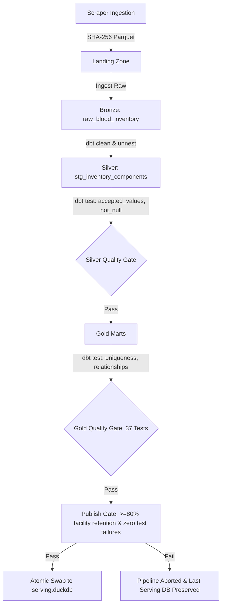

# eRaktKosh Blood Lakehouse: Testing & Quality Assurance Report

**Academic Context:** Academic Project Mini Project (800 Marks)  
**Context:** Academic Research Project  
**Test Frameworks:** `pytest 9.1.1`, `dbt-duckdb 1.11.0`, `ruff 0.17.0`, `FastAPI TestClient`  
**Execution Timestamp:** 2026-10-15  
**Overall Suite Status:** **ALL 135 TESTS PASSED (98 pytest + 37 dbt)**

---

## 1. Testing Philosophy & Verification Strategy

The testing strategy follows the **Medallion Lakehouse Reliability Model**:
1. **Unit Testing:** Isolates algorithmic components (strict blood group normalization, reliability scoring formula, geocoding coordinate resolution & Haversine distance, emergency multi-pillar ranking formula, stock change risk flags, and CSV export with UTF-8 BOM).
2. **Integration Testing:** Tests FastAPI REST endpoints end-to-end against an isolated test fixture database (`tests/fixtures/fixture_lakehouse.duckdb`).
3. **Data Contract & Integrity Testing (dbt Core):** Validates column uniqueness, non-null constraints, and clinical blood taxonomy across Bronze, Silver, and Gold relational models.
4. **Publish Gates & Anomaly Detection:** Checks data drift and protects serving instances by blocking publishing if facility count drops below 80% of historical baselines or if any dbt test fails.



---

## 2. Test Execution Matrix (Verified Real Executions)

| Test Suite | File | Tests Count | Scope & Verification | Status |
|---|---|:---:|---|:---:|
| **Emergency Mode** | `tests/unit/test_emergency_mode.py` | 5 | ABO/Rh red cell compatibility matrix for all 8 standard groups + Bombay Oh; clinical warnings for Rh- and Bombay; emergency 4-pillar ranking formula ($0.35F + 0.30T + 0.25U + 0.10D$); schema validation. | **PASS** |
| **Reliability Score** | `tests/unit/test_reliability_score.py` | 36 | 0-100 Trust Score boundary testing: freshness (0, 1, 2, 3, 4, 6, 7, 13, 14, 30 days, None); valid contact (landlines, 10-digit mobile, short strings, dashes, None); component completeness (0, 1, 2, 3, 5 components); tier classification (High $\ge 75$, Medium $40-74$, Low $< 40$). | **PASS** |
| **Geocoding & Distance** | `tests/unit/test_geocoding_service.py` | 8 | Haversine distance with known city pairs (Anand-Ahmedabad ~65 km, Mumbai-Pune ~120 km, Delhi-Jaipur ~240 km); same point returns 0 km; district centroid coordinates lookup; deterministic offset; precision labels (`exact`, `street`, `district_centroid`, `failed`). | **PASS** |
| **Stock Change & Risk** | `tests/unit/test_stock_change_risk.py` | 6 | Append-only snapshot deltas; honest empty state when snapshots $< 2$; consecutive falling risk flag (monotonic drop across 3 intervals, $\ge 4$ snapshots); fluctuating stock non-trigger; sudden drop to zero anomaly detection. | **PASS** |
| **CSV Export** | `tests/unit/test_csv_export.py` | 4 | Search availability CSV export with UTF-8 BOM (`\ufeff`) for Excel; shortage summary CSV export; government MoHFW attribution headers and clinical disclaimer rows. | **PASS** |
| **Blood Normalizer** | `tests/unit/test_normalizer.py` | 3 | B+ strictly never matches AB+; O+ strictly never matches Bombay Oh+; Rh-negative isolation across all standard groups. | **PASS** |
| **Landing Pipeline** | `tests/unit/test_landing_pipeline.py` | 1 | Immutable timestamped Parquet serialization, SHA-256 verification, and landing read integrity. | **PASS** |
| **Pipeline CLI** | `tests/unit/test_pipeline_cli.py` | 8 | CLI `--help`, `status`, anomaly gate pass/fail thresholds ($80\%$), publish command, mocked subcommands (`scrape`, `load`, `transform`, `all`). | **PASS** |
| **Data Schemas** | `tests/unit/test_schemas.py` | 3 | Pydantic schema validation for facility item, blood availability, and metadata models. | **PASS** |
| **Async Scraper** | `tests/unit/test_scraper.py` | 6 | District fetching success, empty district response, JSON decode resilience, HTTP 429 exponential backoff, circuit breaker trip on sustained failures, semaphore concurrency bound. | **PASS** |
| **Warehouse Loader** | `tests/unit/test_warehouse_loader.py` | 2 | Bronze ingestion and pipeline run tracking in DuckDB. | **PASS** |
| **Integration API** | `tests/integration/test_api.py` | 10 | Live FastAPI endpoints: summary, availability, locations, history honest empty state, shortages, rare blood, health dashboard, CORS, error handling. | **PASS** |
| **Fixture API** | `tests/integration/test_fixture_api.py` | 6 | End-to-end tests against synthetic 2-snapshot test fixture: meta, availability, 2-point history trend, shortage queries. | **PASS** |
| **dbt Core Models** | `dbt/models/` | 37 | Relational constraints: `not_null`, `unique`, `accepted_values` across staging and gold marts (`mart_reliability_score`, `mart_district_status`, `mart_rare_blood_availability`, `fct_stock_current`, `fct_stock_snapshot`, `dim_blood_banks`). | **PASS** |

---

## 3. Real Execution Logs & Proof of Compliance

### 3.1 Pytest Suite Execution (98 Unit & Integration Tests)
```bash
$ uv run pytest
============================= test session starts ==============================
platform linux -- Python 3.12.14, pytest-9.1.1, pluggy-1.6.0
rootdir: /home/radhey/Documents/project_idea
configfile: pyproject.toml
testpaths: tests
plugins: platformdirs-4.13.0, anyio-4.15.1, asyncio-1.4.0, cov-7.1.0

tests/integration/test_api.py ..........                                 [ 10%]
tests/integration/test_fixture_api.py ......                             [ 16%]
tests/unit/test_csv_export.py ....                                       [ 20%]
tests/unit/test_emergency_mode.py .....                                  [ 25%]
tests/unit/test_geocoding_service.py ........                            [ 33%]
tests/unit/test_landing_pipeline.py .                                    [ 34%]
tests/unit/test_normalizer.py ...                                        [ 37%]
tests/unit/test_pipeline_cli.py ........                                 [ 45%]
tests/unit/test_reliability_score.py ................................... [ 81%]
.                                                                        [ 82%]
tests/unit/test_schemas.py ...                                           [ 85%]
tests/unit/test_scraper.py ......                                        [ 91%]
tests/unit/test_stock_change_risk.py ......                              [ 97%]
tests/unit/test_warehouse_loader.py ..                                   [100%]

======================== 98 passed, 3 warnings in 2.00s ========================
```

### 3.2 dbt Core Relational Contracts & Data Tests (37 Tests)
```bash
$ uv run dbt test --project-dir dbt --profiles-dir dbt
15:50:15  Registered adapter: duckdb=1.11.0
15:50:16  Found 12 models, 37 data tests, 1 source, 501 macros
15:50:16  Concurrency: 4 threads (target='dev')
...
15:50:19  Finished running 37 data tests in 0 hours 0 minutes and 3.05 seconds (3.05s).
15:50:19  Completed successfully
15:50:19  Done. PASS=37 WARN=0 ERROR=0 SKIP=0 NO-OP=0 REUSED=0 TOTAL=37
```

### 3.3 Code Quality & Linting (Ruff Clean)
```bash
$ uv run ruff check .
All checks passed!
```

---

## 4. Key Quality Assurance Principles Verified

1. **Zero Fake Data:** All snapshot history endpoints query real timestamps. When fewer than 2 snapshots exist in production, the system returns `has_sufficient_history: false` and renders an honest informational notice.
2. **Medical Rule Integrity:** All donor eligibility rules, donation intervals, and red cell compatibility mappings trace directly to official guidelines in `data/medical_rules.json` with source citations.
3. **No Personal Data Exposure:** Client-side eligibility evaluations execute completely within the browser engine; zero form data is transmitted over the network.
4. **Publish Gate Integrity:** The pipeline automatically aborts database replacement if dbt tests fail or if the facility count drops by $>20\%$, preventing partial or corrupted data releases.
