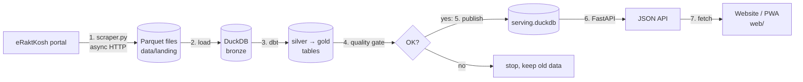

# 00 · Start Here

**What you will learn**
- What Raktsetu is and who it is for
- How the whole system works, in 2 minutes
- Which guide to read first
- Where every file in the project lives

---

## 1. What is Raktsetu?

**Raktsetu** ("blood bridge") helps people find blood quickly in India.

India's government runs a portal called **eRaktKosh**. Blood banks report their stock there. The data is
public, but it is hard to use in an emergency:

- You search one district at a time.
- You cannot see compatible groups. (An O- patient can only get O- red cells. An AB+ patient can get any group.)
- You cannot tell if the data is fresh or 3 weeks old.
- It does not work well on a slow mobile connection.

Raktsetu fixes this. It:

1. **collects** the stock of every blood bank in India, district by district, from eRaktKosh;
2. **cleans and checks** the data;
3. **shows** it in a fast, mobile-friendly website that also works offline.

In the code, the Python package is called **`bloodlake`**. Old files also use the name "BloodGrid".
All three names mean the same project.

### Who uses it?

| User | What they do |
|------|--------------|
| Patient's family | Search for a blood group near them, then call the blood bank |
| Doctor / hospital staff | Use **Emergency Mode** to find compatible units, ranked by freshness and distance |
| Health official | Look at district shortages, rare blood stock and CSV exports |
| Blood donor | Check if they can donate, and find where stock is low |
| Operator (you) | Run the data pipeline, watch data health and fix problems |

---

## 2. The 2-minute tour



1. **Scrape.** [`scraper.py`](../../src/bloodlake/scraper.py) calls eRaktKosh once for each district,
   10 requests at a time.
2. **Land.** The raw answers are saved as a **Parquet** file. That file is never changed again.
3. **Load.** The Parquet file is copied into the **bronze** table of a DuckDB database (`blood_warehouse.duckdb`).
4. **Transform.** **dbt** runs SQL models. **Silver** models clean the data; **gold** models build the
   tables the website needs (current stock, trust score, shortages, and more).
5. **Gate.** If the number of blood banks fell by more than 20 %, the pipeline stops. Bad data never goes live.
6. **Publish.** The warehouse is copied to `serving.duckdb` in one atomic step.
7. **Serve.** **FastAPI** reads `serving.duckdb` and returns JSON. The website in `web/` calls it and
   draws cards, maps and charts.

All of this runs with one command: `make pipeline`. GitHub Actions can also run it every 6 hours.

---

## 3. Reading order

| You are… | Read in this order |
|----------|--------------------|
| **A beginner** | 01 → 02 → 03 → 04 → 05 → 08 → 10 → 16 |
| **The owner, fixing a bug** | 13 (troubleshooting) first, then the guide for the part that broke |
| **Building your own similar project** | 01 → 04 → 14 → 15 |
| **Preparing for the viva** | 00 → 04 → 09 → 16 (FAQ) |

| # | Guide | One line |
|---|-------|----------|
| 01 | [Concepts for beginners](01_CONCEPTS_FOR_BEGINNERS.md) | Every idea you need, explained simply |
| 02 | [Installation](02_INSTALLATION.md) | Set it up on your computer |
| 03 | [User guide](03_USER_GUIDE.md) | How to use every screen |
| 04 | [Architecture](04_ARCHITECTURE.md) | The big picture and why it is built this way |
| 05 | [Data pipeline](05_DATA_PIPELINE.md) | Scrape → land → bronze → gate → publish, with code |
| 06 | [dbt models](06_DBT_MODELS.md) | Every SQL model explained |
| 07 | [Database](07_DATABASE.md) | Tables, columns and useful queries |
| 08 | [Backend API](08_BACKEND_API.md) | Every endpoint |
| 09 | [Domain logic](09_DOMAIN_LOGIC.md) | Blood compatibility, trust score, distance |
| 10 | [Frontend](10_FRONTEND.md) | HTML, JavaScript, CSS and the PWA |
| 11 | [Testing](11_TESTING.md) | How the project is tested |
| 12 | [Deployment & operations](12_DEPLOYMENT_AND_OPERATIONS.md) | Docker, CI and day-to-day running |
| 13 | [Troubleshooting](13_TROUBLESHOOTING.md) | Symptom → check → fix |
| 14 | [Build it yourself](14_BUILD_IT_YOURSELF.md) | Rebuild a mini version from zero |
| 15 | [Tech stack reference](15_TECH_STACK_REFERENCE.md) | Each tool: what, why, top commands |
| 16 | [Glossary & FAQ](16_GLOSSARY_AND_FAQ.md) | Terms and viva questions |

---

## 4. Map of the repository

```text
project_idea/
├── Makefile                    ← all the short commands (make run, make pipeline, …)
├── pyproject.toml              ← Python dependencies + the "bloodlake" CLI entry point
├── uv.lock                     ← exact versions of every dependency (made by uv)
├── .python-version             ← Python 3.12
├── .env.example                ← example settings (see guide 02, section 4)
├── Dockerfile                  ← builds a container image of the API + website
├── docker-compose.yml          ← runs that container on port 8000
│
├── src/bloodlake/              ← ALL Python code
│   ├── config.py               ← settings: paths, scraper limits, gate threshold
│   ├── scraper.py              ← async crawler + Parquet writer + run-interval guard
│   ├── pipeline.py             ← CLI: scrape / load / transform / test / publish / all / status
│   ├── db.py                   ← opens DuckDB connections (read-only for the API)
│   ├── medical.py              ← blood group compatibility rules
│   ├── scoring.py              ← trust (reliability) score in Python
│   ├── geo.py                  ← district coordinates + Haversine distance
│   ├── export.py               ← CSV export (Excel-safe)
│   └── api/
│       ├── main.py             ← FastAPI app, static files, /api/search
│       ├── routes.py           ← all /api/v1/... endpoints
│       └── schemas.py          ← Pydantic response models
│
├── dbt/                        ← SQL transformations
│   ├── dbt_project.yml         ← silver = views, gold = tables
│   ├── profiles.yml            ← which DuckDB file dbt writes to
│   ├── macros/normalize_blood_group.sql
│   └── models/
│       ├── silver/             ← stg_blood_banks, stg_inventory_components (+ sources.yml, schema.yml)
│       └── gold/               ← dim_, fct_, mart_ tables (+ schema.yml tests)
│
├── web/                        ← the website (no framework, plain HTML/CSS/JS)
│   ├── index.html              ← all page sections
│   ├── js/app.js               ← all browser logic
│   ├── css/style.css           ← all styles, responsive rules
│   ├── sw.js                   ← service worker (offline support)
│   ├── manifest.json           ← makes it installable as an app
│   └── assets/                 ← icons
│
├── data/
│   ├── eraktkosh_all_metadata.json   ← list of states + districts + their codes (scraper input)
│   ├── medical_rules.json            ← compatibility + donor rules with sources
│   ├── district_coords.json          ← latitude/longitude of every district
│   └── landing/dt=YYYY-MM-DD/hh=HH/  ← raw Parquet files (one per scrape)
│
├── blood_warehouse.duckdb      ← working database (pipeline writes here)
├── serving.duckdb              ← published copy (API reads here)
├── demo/                       ← offline demo database
│
├── tests/
│   ├── unit/                   ← fast tests for each module
│   ├── integration/            ← API tests against a real or fixture DB
│   └── fixtures/generate_fixture_db.py
│
├── scripts/
│   ├── data/geocode_districts.py     ← builds data/district_coords.json
│   └── report/                       ← diagrams, screenshots, DOCX/PDF report builder
│
├── docs/
│   ├── guide/                  ← YOU ARE HERE
│   ├── adr/                    ← Architecture Decision Records (why we chose X)
│   ├── diagrams/, screenshots/ ← images used in the docs and the report
│   └── academic/, learning/    ← report notes, viva prep, DuckDB/dbt learning notes
│
└── .github/workflows/          ← ci.yml, pipeline.yml (every 6 h), deploy.yml
```

---

Next: [01 · Concepts for beginners →](01_CONCEPTS_FOR_BEGINNERS.md)
