# 03 · User Guide

**What you will learn**
- How to use every part of the website, on desktop and mobile
- What each number, colour and badge means

> **Medical note:** Raktsetu shows what blood banks *reported* to eRaktKosh. Always **call the blood bank**
> before travelling. Compatibility hints are guidance, not medical advice.

---

## 1. Home and the top bar

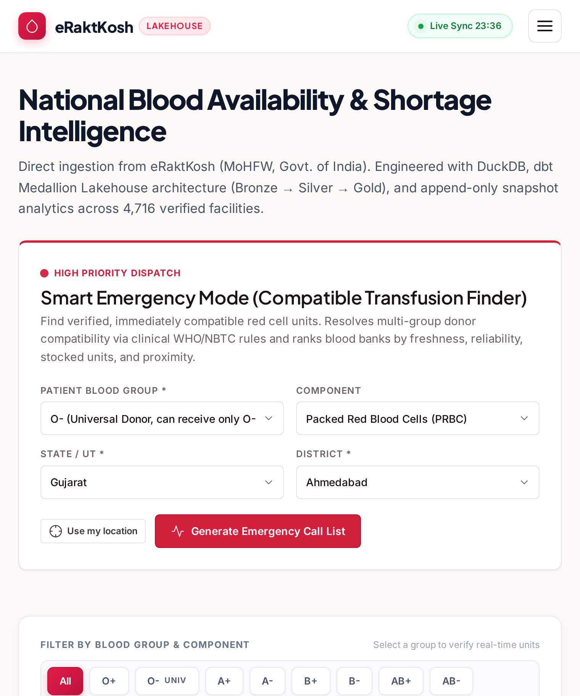

- **Top bar:** links to each section. On a phone, tap **☰** to open the menu.
- **Hero area:** the total number of blood banks tracked, and when the data was last synced.
- **KPI cards:**

| Card | Meaning |
|------|---------|
| Total banks | Blood banks in the database |
| Fresh | Banks that updated in the **last 24 hours** |
| Stale | Banks that have **not updated for more than 30 days**; treat their numbers with care |
| Updated today | Banks that updated today |

- A **yellow banner** at the top means the data is old (more than 12 h since the last sync) or you are offline.

---

## 2. Emergency Mode

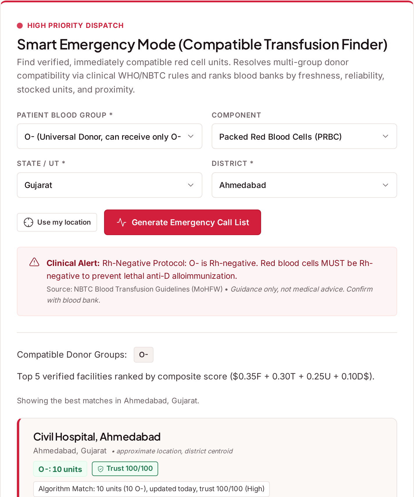

Use this when a patient needs blood **now**.

1. Choose the **patient's blood group**, such as `O-`, `AB+` or `Bombay (Oh+)`.
2. Choose the **component**, for example *Packed Red Blood Cells*, *Platelets* or *Plasma*.
3. *(Optional)* Choose a state or district, **or** press **Use my location**.
4. Press **Find blood**.

What you get:
- **Compatible donor groups.** For example, an `A+` patient can receive red cells from `A+`, `A-`, `O+` and `O-`.
- **Red alert box** for Rh-negative or Bombay groups. These patients have very limited options.
- **Ranked cards.** Each card shows:
  - total compatible units and units per group;
  - how fresh the data is, and the trust score;
  - the distance, if you shared your location;
  - **"Why ranked here"**: one sentence explaining the rank;
  - a **Call** button (`tel:` link).

With "Use my location", the search tries **50 km** first, then **150 km**, then **400 km**, until it finds results.

---

## 3. Blood Finder (search)

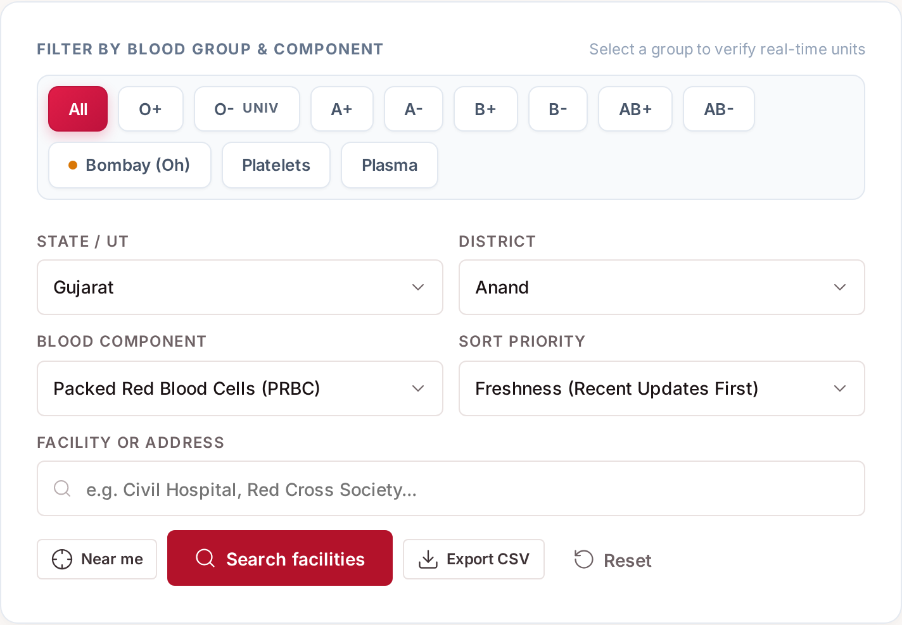

1. Choose **State**. The district list then fills in.
2. Choose **District** (optional).
3. Choose **Component**.
4. Tap a **blood group** button (or *All*).
5. *(Optional)* Type part of a hospital name or address and press Enter.
6. **Sort by:** freshness, most units, trust score, or distance (distance needs "Near me").

The URL updates as you search (`?state=Gujarat&district=Anand`). You can bookmark it or send it, and it
opens with the same filters. **Reset** clears all filters.

### The blood bank card

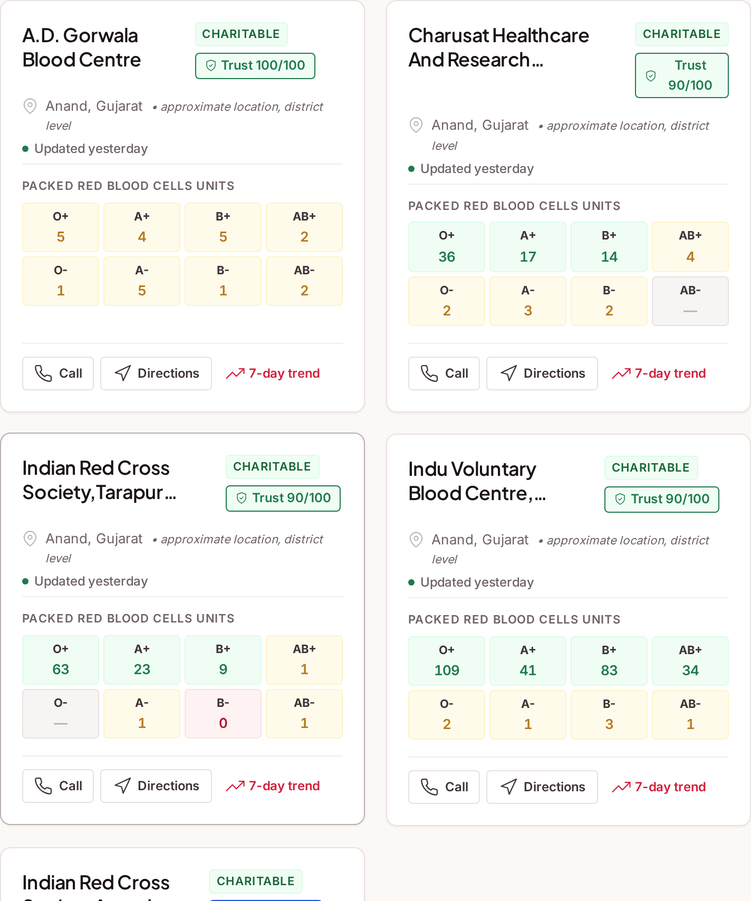

| Part | Meaning |
|------|---------|
| Name, district, type (Govt./Private/Charitable) | Who it is |
| 8 blood group tiles | Units of each group. Green = in stock, amber = low, red = none |
| **Trust badge** (High / Medium / Low) | How far you can rely on this bank's data. Click it for the formula |
| "Updated X days ago" | When the bank last reported to eRaktKosh |
| **Call** | Calls the bank's first phone number |
| **Trend** | Opens a chart of stock over time |

Use the page buttons at the bottom to move through the results. You can also change how many cards are
shown per page.

### Trust score

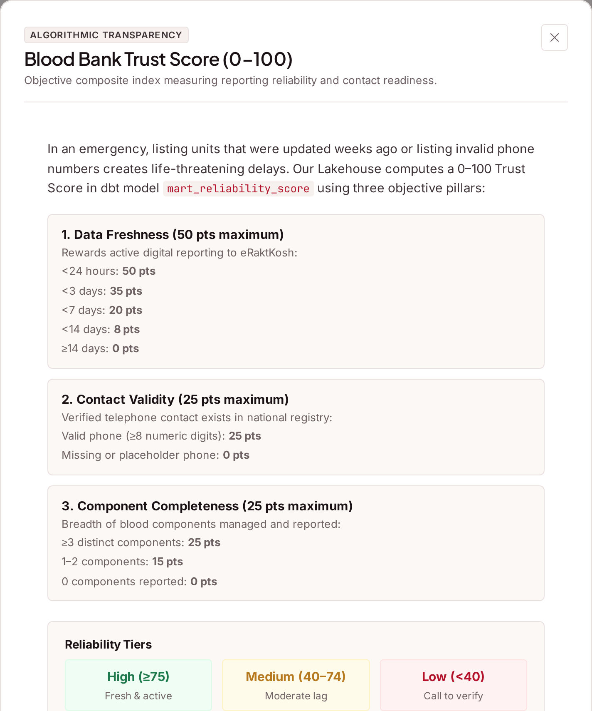

The score goes from 0 to 100 and adds up three parts:

| Part | Points |
|------|--------|
| **Freshness** | 50 if updated in the last day, 35 within 3 days, 20 within 6 days, 8 within 13 days, 0 if older |
| **Valid phone** | 25 if the contact has at least 8 digits |
| **Components** | 25 if the bank reports 3 or more component types, 15 if it reports 1–2 |

**High** = 75 or more, **Medium** = 40–74, **Low** = below 40.
A worked example is in [09](09_DOMAIN_LOGIC.md#2-trust-reliability-score).

### Trend chart

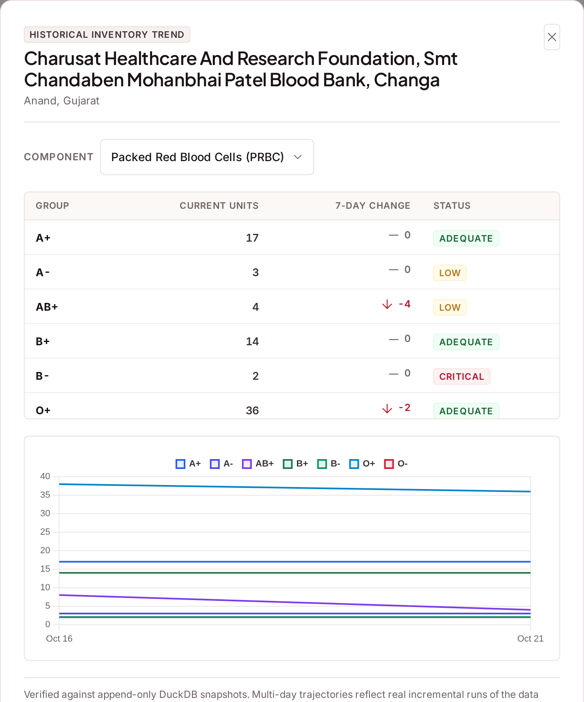

Shows units per blood group across past snapshots (up to 14 days). Use the dropdown to change the
component. Gaps in the line mean there was no snapshot that day. It does **not** mean zero units.

---

## 4. Map view

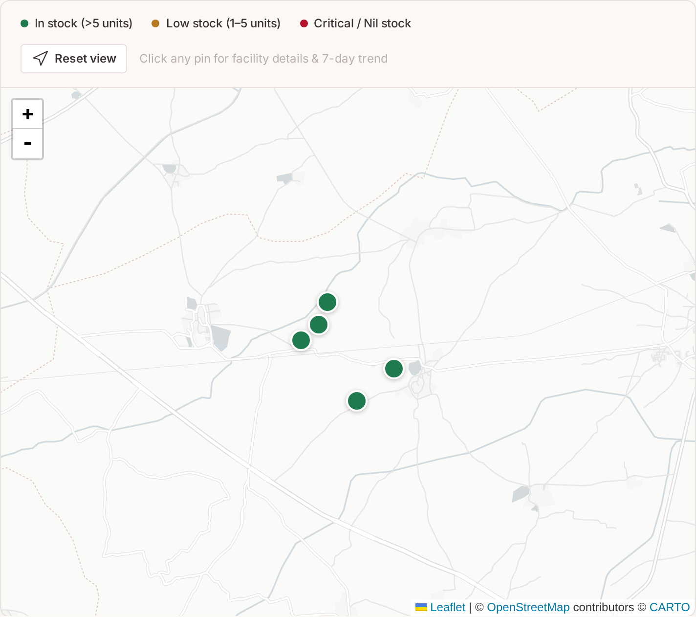

Press **Map** to see the search results as pins.
- Click a pin to see the bank's name, units and a call link.
- **Near me** puts a blue dot at your position.
- **Note:** pins are placed at the **district centre**, with a small spread so they don't stack on top of
  each other. The exact hospital address is on the card.

---

## 5. Network chart, Rare Blood Radar and Shortages

- **Network chart** ([screenshot](../screenshots/07_network_chart.png)): the states with the most blood banks.
- **Rare Blood Radar** ([screenshot](../screenshots/08_rare_blood.png)): where **Rh-negative** and
  **Bombay** units are in stock right now. Bombay is listed first.
- **District Shortages** ([screenshot](../screenshots/09_shortages.png)): districts with little stock of a
  chosen group or component.

| Status | Total units in the district | Severity |
|--------|-----------------------------|----------|
| Critical depletion | 0 | 100 |
| High shortage | 1–5 | 75 |
| Moderate shortage | 6–15 | 40 |
| Adequate | more than 15 | 10 |

---

## 6. CSV export

There are two download buttons:
- **Availability CSV:** one row per bank, component and group, using your current search filters.
- **Shortages CSV:** the current shortage table.

The files open correctly in **Excel**, **Google Sheets** and **pandas**. The CSV is UTF-8 with a BOM, so
Hindi and other Indian-language names display correctly. Phone and email are split into separate columns,
and times are in IST.

---

## 7. Donor eligibility checker

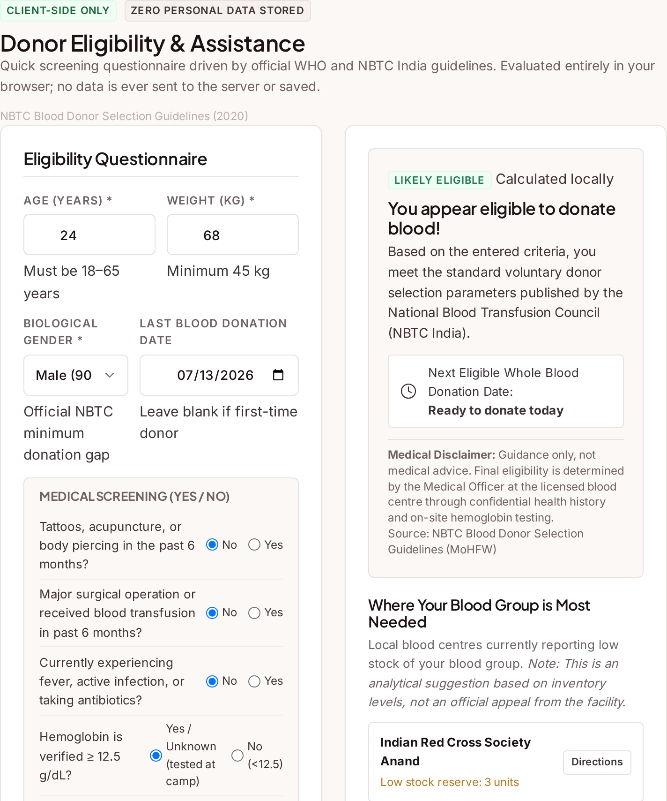

Enter your age, weight, gender and last donation date, and answer the health questions. The result is
**Likely Eligible** or **Temporarily Deferred**, with the reasons and your next eligible date.

The rules (NBTC India):
- age 18–65;
- weight at least 45 kg;
- haemoglobin at least 12.5 g/dL;
- at least **90 days** since the last donation for men, **120 days** for women;
- no tattoo or surgery in the last 6 months.

---

## 8. Data Health panel

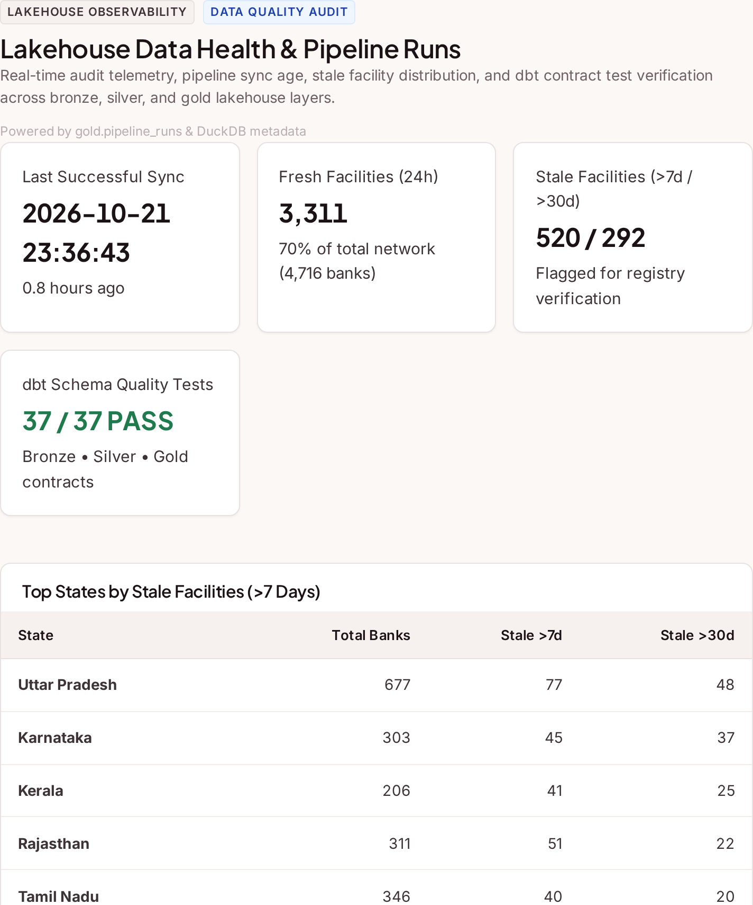

This panel is for operators and examiners. It shows:
- **Last sync** and **sync age**;
- **Stale by state**: how many banks in each state report old data;
- **Recent pipeline runs**, with status and number of banks;
- **dbt tests**: passed / total.

---

## 9. Mobile and offline

| | |
|---|---|
| 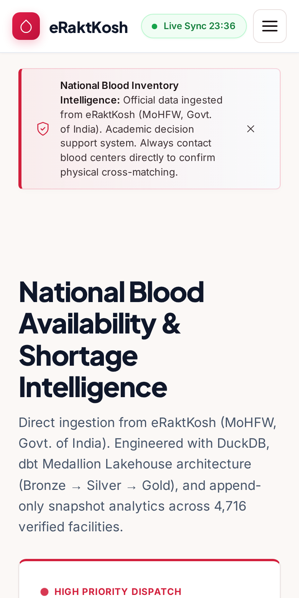 | 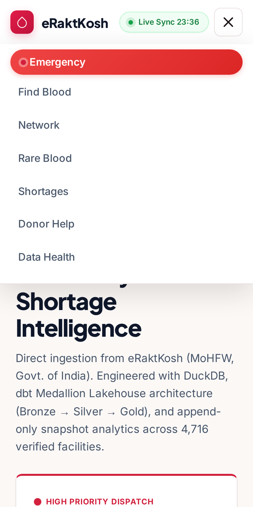 |

- Tap **☰** to open the menu.
- **Install as an app:** in Chrome, open the menu (⋮) and choose **Add to Home screen**.
- **Offline:** pages and results you opened before still load. A banner tells you that you are offline.

---

Next: [04 · Architecture →](04_ARCHITECTURE.md)
