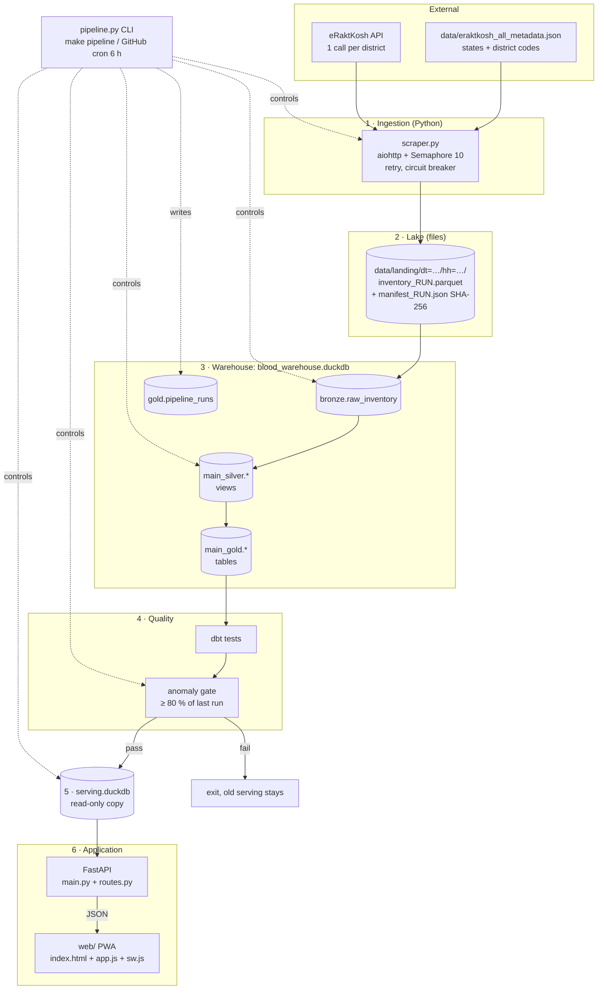
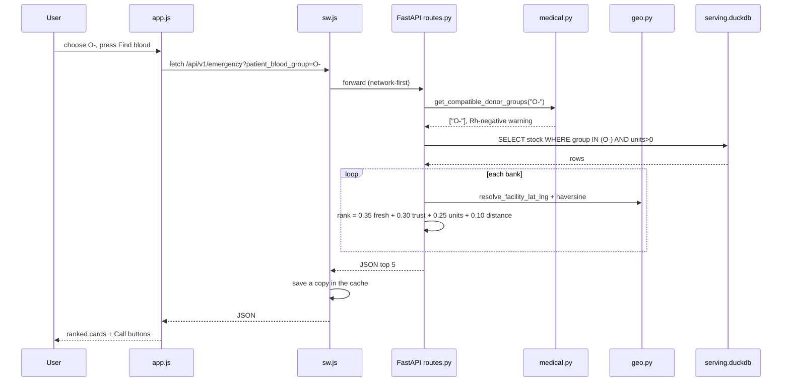

# 04 · Architecture

**What you will learn**
- The full system on one diagram
- Why each layer exists
- Which folder belongs to which layer
- The big design decisions and their trade-offs

---

## 1. The whole system



The same diagram, as a picture for the report, is in `docs/diagrams/architecture_diagram.png`.

---

## 2. Why each layer exists

| Layer | Folder / file | Why it exists | What breaks without it |
|-------|---------------|---------------|------------------------|
| **Ingestion** | `src/bloodlake/scraper.py` | eRaktKosh has no "download everything" button, so we must ask about 780 districts one by one | No data |
| **Landing (lake)** | `data/landing/` | Keeps the exact raw answer forever (immutable, with a SHA-256 hash). We can rebuild everything from it and prove where the data came from. | A bad cleaning rule would destroy data for good |
| **Bronze** | `bronze.raw_inventory` | Raw data inside a database, so SQL can read it | dbt cannot read the files easily |
| **Silver** | `dbt/models/silver/` | Cleans the data: trims text, converts types, keeps one row per bank, and splits the components JSON into one row per group | Messy names, duplicate banks, unreadable stock |
| **Gold** | `dbt/models/gold/` | Answers business questions: current stock, trust, shortages, rare groups, trends | The API would need huge, slow SQL |
| **Gate** | `pipeline.py test` + dbt tests | Stops broken scrapes (for example eRaktKosh being half down) from replacing good data | Users would suddenly see "0 banks" |
| **Serving DB** | `serving.duckdb` | A separate read-only copy, so the pipeline can write while the API reads | DuckDB file lock errors, or a half-updated site |
| **API** | `src/bloodlake/api/` | One safe, validated, documented way to read data | The browser would have to query the DB directly, which is impossible and unsafe |
| **PWA** | `web/` | A fast UI that works on any phone, can be installed, and works offline | — |
| **Orchestration** | `pipeline.py`, `Makefile`, `.github/workflows/pipeline.yml` | Runs the steps in order, records each run, and repeats every 6 h | Manual work every time |

---

## 3. One request, end to end

What happens when a user presses **Find blood** in Emergency Mode for `O-`:



---

## 4. Key design decisions

The full reasoning for each decision is in [`docs/adr/`](../adr/).

| Decision | Chosen | Alternatives | Why | Trade-off |
|----------|--------|--------------|-----|-----------|
| Analytics database | **DuckDB** ([ADR-001](../adr/ADR-001-duckdb-for-analytics-postgres-for-app-state.md)) | PostgreSQL, SQLite, BigQuery | No server to run, very fast at GROUP BY over 100k rows, reads Parquet directly, free | Only one process can write at a time, which is why we have the serving copy |
| Transformations | **dbt** ([ADR-002](../adr/ADR-002-dbt-incremental-mart-design.md)) | Python/pandas scripts | SQL is easy to read, models run in dependency order, tests are built in, docs are generated | One more tool to learn |
| Raw storage | **Parquet** | CSV, JSON | Small, typed, columnar, and DuckDB reads it natively | Not human-readable without a tool |
| Scheduling | **GitHub Actions cron** ([ADR-004](../adr/ADR-004-github-actions-vs-airflow.md)) | Airflow, cron on a VPS | Free, nothing to host | Not exact to the minute; runs can be delayed |
| API | **FastAPI** | Flask, Django | Automatic `/docs`, Pydantic validation, fast | — |
| Frontend | **Vanilla JS** | React, Vue | No build step, small, works on cheap phones | `app.js` is long (about 2000 lines) |
| Forecasting | **Not yet** ([ADR-003](../adr/ADR-003-why-no-ml-forecasting-yet.md)) | ML models | Not enough clean history yet; a wrong forecast in a medical setting is risky | No predictions |
| Hosting | **Small VPS + Caddy** ([ADR-005](../adr/ADR-005-low-cost-vps-caddy-deployment.md)) | AWS, Fly.io | Costs about $4/month, automatic HTTPS | You manage the server yourself |
| Locations | **District centre + small offset** | Geocoding every hospital address | eRaktKosh addresses are messy; district-level accuracy is honest | Pins are approximate (marked `is_approximate_location`) |

---

## 5. Two database files: why?

```text
blood_warehouse.duckdb   ← the pipeline WRITES here (bronze, silver, gold, pipeline_runs)
        │  copy  (shutil.copyfile → serving.duckdb.tmp)
        │  rename (os.replace → serving.duckdb)   ← atomic
        ▼
serving.duckdb           ← the API only READS this (read_only=True)
```

DuckDB allows **one writer** per file. If the API read the same file the pipeline writes to, users would
get lock errors during each run, or see half-built tables. With two files, the site keeps serving the
last good data until the new copy is ready.

[`db.py`](../../src/bloodlake/db.py) `get_serving_connection` tries `serving.duckdb` first and
falls back to the warehouse if serving does not exist yet.

---

## 6. Schema names you will see

dbt adds its custom schema name to the default `main` schema:

| dbt config | Real schema in DuckDB | Example |
|------------|-----------------------|---------|
| source `bronze` | `bronze` | `bronze.raw_inventory` |
| `+schema: silver` | `main_silver` | `main_silver.stg_blood_banks` |
| `+schema: gold` | `main_gold` | `main_gold.fct_stock_current` |
| created by Python | `gold` | `gold.pipeline_runs` |

So in API SQL you will always see `main_gold.…`.

---

Next: [05 · Data pipeline →](05_DATA_PIPELINE.md)
