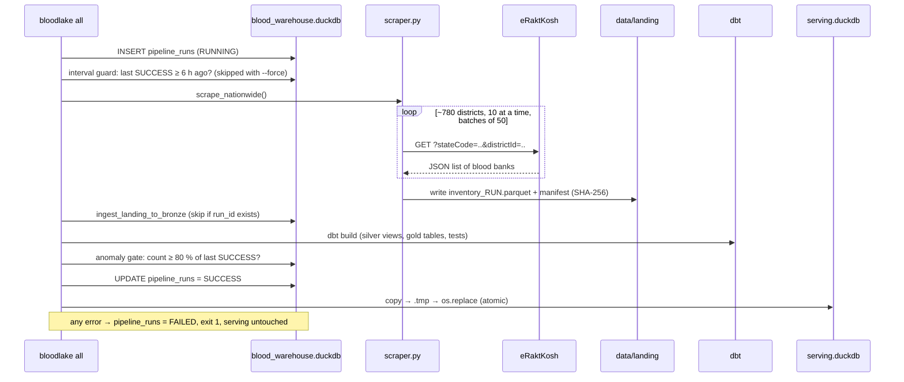

# 05 · Data Pipeline

**What you will learn**
- Exactly what each pipeline step does, with the real code
- What the raw data looks like
- How the safety features work: retry, circuit breaker, interval guard, idempotency, gate, atomic publish
- How to re-run, back-fill and debug the pipeline

All the steps live in two files:
- [`src/bloodlake/scraper.py`](../../src/bloodlake/scraper.py) does the network work and writes Parquet;
- [`src/bloodlake/pipeline.py`](../../src/bloodlake/pipeline.py) is the CLI (built with Typer) that runs every step.

`pyproject.toml` turns `pipeline.py` into a command called `bloodlake`:
```toml
[project.scripts]
bloodlake = "bloodlake.pipeline:app"
```

| Make | CLI | Function |
|------|-----|----------|
| `make scrape` | `bloodlake scrape` | `scrape()` |
| `make load` | `bloodlake load [--file X]` | `load()` → `ingest_landing_to_bronze()` |
| `make transform` | `bloodlake transform` | `transform()` → `dbt build` |
| `make gate` | `bloodlake test` | `test()` |
| `make publish` | `bloodlake publish` | `publish()` |
| `make pipeline` | `bloodlake all --force` | `all()` |
| `make status` | `bloodlake status` | `status()` |

---

## 1. One full run



---

## 2. Step 1: Scrape

### Where the district list comes from
`data/eraktkosh_all_metadata.json` lists every state with its `stateCode`, and every district with its
`districtCode`. `scrape_nationwide()` reads it and builds one task per district:

```python
for state_item in catalog["States_and_Districts"]:
    for d in state_item.get("districts", []):
        tasks_metadata.append({
            "state_name": state_item.get("stateName", ""),
            "state_code": str(state_item.get("stateCode", "")),
            "district_name": d.get("districtName", ""),
            "district_id": str(d.get("districtCode", "")),
        })
```

### One district request: `fetch_district_data()`
```python
url = f"{settings.eraktkosh_base_url}?stateCode={state_id}&districtId={district_id}"
headers = {"User-Agent": settings.user_agent, "Accept": "application/json, text/plain, */*"}

for attempt in range(1, max_retries + 1):
    backoff = 0.0
    async with semaphore:                      # ← at most 10 requests at the same time
        async with session.get(url, headers=headers, timeout=timeout) as response:
            if response.status == 429 or response.status >= 500:
                backoff = (2**attempt) + random.uniform(0.5, 1.5)   # 2s, 4s, 8s + jitter
            elif response.status == 200:
                blood_banks = json.loads(await response.text())
                for bank in blood_banks:        # add our own location labels
                    bank["State"] = state_name
                    bank["District"] = district_name
                return True, blood_banks, None
    if backoff:
        await asyncio.sleep(backoff)            # sleep OUTSIDE the semaphore
```

What each part does:
- **Semaphore:** like a room with 10 chairs. An 11th request waits until a chair is free.
- **Exponential backoff:** each retry waits twice as long. The random **jitter** stops all the waiting
  requests from retrying at the same moment.
- **Sleeping outside the semaphore:** a request that is waiting does not take a chair, so the other
  districts keep downloading.
- It returns `(success, list_of_banks, error)` and never raises an error. One bad district cannot stop the whole run.

### Batches and the circuit breaker
```python
batch_size = 50
for i in range(0, total_districts, batch_size):
    results = await asyncio.gather(*tasks[i:i+batch_size])
    ...
    if completed >= 30 and error_rate > 0.20:
        raise CircuitBreakerError(...)          # CLI exits with code 2
```
If more than 20 % of districts fail (after at least 30 have been tried), eRaktKosh is probably down or
blocking us. Saving half the data would look like a real shortage, so the run stops.

### The run-interval guard
`check_run_interval_guard()` reads the last `SUCCESS` from `gold.pipeline_runs`. If it was less than
`min_run_interval_hours` (6) ago, it raises `RunIntervalGuardError`. Pass `--force` to skip it.
(Note the timezone fix explained in [01](01_CONCEPTS_FOR_BEGINNERS.md#timezones).)

### What one raw record looks like
```json
{
  "hospitalCode": 31003,
  "hospitalname": "Pillar Health Centre",
  "hospitalType": "Charitable/Vol",
  "type": "Blood Bank",
  "hospitalcontact": "Phone: 9679535438 ,Fax: 0, Email: pillar.portblair@gmail.com",
  "hospitaladd": "Lamba Line, ... Port Blair",
  "entrydate": "2026-10-14 00:27:49",
  "components": {
    "Packed Red Blood Cells": {
      "available_WithQty": "A+Ve : 3, O+Ve : 5",
      "not_available_WithQty": "AB-Ve : 0, A-Ve : 0, ..."
    },
    "Plasma": { "...": "..." }
  },
  "State": "Andaman and Nicobar Islands",
  "District": "South Andaman"
}
```
- `entrydate` is when **the blood bank** last updated eRaktKosh. That is the "freshness".
- The stock sits inside `components → <name> → available_WithQty`, as text like `"A+Ve : 3"`.
  Silver turns this into proper rows ([06](06_DBT_MODELS.md)).

---

## 3. Step 2: Landing (immutable Parquet)

`write_landing_parquet(records, run_id, scraped_at)`:

```text
data/landing/
└── dt=2026-10-22/          ← date partition
    └── hh=06/              ← hour partition
        ├── inventory_pipeline_20261022_060012_ab12cd.parquet
        └── manifest_pipeline_20261022_060012_ab12cd.json
```

- **Partitioning** (`dt=`, `hh=`) makes it easy to find or delete one day's data.
- **Immutable:** if the file already exists, the function raises `FileExistsError` and never overwrites it.
- Columns: `run_id, scraped_at, hospital_code, hospital_name, state_name, district_name, hospital_type,
  facility_type, hospital_contact, hospital_address, entry_date_raw, components_raw, raw_payload_json`.
  `raw_payload_json` keeps the **whole** original record, so nothing is ever lost.
- Compression: **zstd**.
- The **manifest** stores the row count and a **SHA-256** hash. If the file is changed later, the hash
  will no longer match:
  ```bash
  sha256sum data/landing/dt=*/hh=*/inventory_*.parquet
  ```

---

## 4. Step 3: Load into bronze

`ingest_landing_to_bronze(con, parquet_path=None)`:
1. If no file is given, it picks the **newest** file in `data/landing/`.
2. It creates `bronze.raw_inventory` if it is missing.
3. **Idempotency check:**
   ```python
   file_run_ids = [r[0] for r in con.execute(
       "SELECT DISTINCT run_id FROM read_parquet(?);", [str(target_file)]).fetchall()]
   already = con.execute(
       "SELECT COUNT(*) FROM bronze.raw_inventory WHERE list_contains(?, run_id);",
       [file_run_ids]).fetchone()[0]
   if already:
       return 0          # loaded before → do nothing
   ```
4. `INSERT INTO bronze.raw_inventory (...) SELECT ... FROM read_parquet(?)`.
   The path is passed as a **parameter** (`?`), never pasted into the SQL string. This blocks SQL
   injection and also handles file names with special characters.

Bronze keeps **every** run. That history is what feeds the trend chart.

---

## 5. Step 4: Transform (dbt)

`transform()` runs:
```bash
uv run dbt build --project-dir dbt --profiles-dir dbt
```
`dbt build` = run every model **and** every test, in dependency order. If a test fails, the CLI exits
with dbt's error code and the pipeline stops. The models are explained in [06](06_DBT_MODELS.md).

---

## 6. Step 5: Anomaly gate

```python
current_count = con.execute("SELECT COUNT(*) FROM main_gold.dim_blood_banks;").fetchone()[0]
prev_count = get_last_successful_run(con).get("facilities_count")
ratio = current_count / prev_count
if ratio < settings.min_facility_threshold_ratio:      # 0.80
    raise typer.Exit(code=3)
```
**Example:** the last run had 4,716 banks. Today eRaktKosh failed for a few states and we only got
3,000, which is 63.6 %. The gate fails, the site keeps showing yesterday's data, and the run is
recorded as `FAILED`.

To change the threshold, set `MIN_FACILITY_THRESHOLD_RATIO=0.7` in `.env`.

---

## 7. Step 6: Atomic publish

```python
shutil.copyfile(settings.warehouse_path, settings.serving_staging_path)   # → serving.duckdb.tmp
os.replace(settings.serving_staging_path, settings.serving_path)          # atomic rename
```
If the copy fails halfway, only the `.tmp` file is broken, and the live `serving.duckdb` is untouched.

In `all()`, the run is marked `SUCCESS` **before** the publish, so the published copy already contains
the finished run record. That lets the Data Health panel show it.

---

## 8. Run records: `gold.pipeline_runs`

| Column | Meaning |
|--------|---------|
| `run_id` | e.g. `pipeline_20261022_060012_ab12cd` |
| `started_at`, `finished_at` | When the run started and finished |
| `status` | `RUNNING` → `SUCCESS`, `SUCCESS_NO_SCRAPE` (with `--skip-scrape`) or `FAILED` |
| `facilities_count` | Banks in gold after the run (used by the next gate) |
| `tests_passed` | Whether the dbt tests and gate passed |
| `error_message` | Why it failed |

```bash
make status
uv run python -c "import duckdb;print(duckdb.connect('blood_warehouse.duckdb',read_only=True).sql('select * from gold.pipeline_runs order by started_at desc limit 5'))"
```

---

## 9. Re-running and back-filling

| Goal | Command |
|------|---------|
| Rebuild gold after changing SQL, with no new scrape | `uv run bloodlake all --skip-scrape` |
| Load one specific old file | `uv run bloodlake load --file data/landing/dt=2026-10-15/hh=06/inventory_X.parquet` |
| Load all old files (back-fill) | `for f in data/landing/dt=*/hh=*/*.parquet; do uv run bloodlake load --file "$f"; done` then `make transform publish` |
| Scrape now, ignoring the 6 h guard | `uv run bloodlake scrape --force` |
| Gentler scraping | `uv run bloodlake scrape -c 4` |

Because the load is idempotent, running the back-fill loop twice is safe.

---

## 10. Exit codes

| Code | Meaning |
|------|---------|
| 0 | Success |
| 1 | Pipeline failed (see `error_message`) |
| 2 | Circuit breaker triggered while scraping |
| 3 | Anomaly gate failed |
| other | Returned by dbt (a model or test failed) |

---

Next: [06 · dbt models →](06_DBT_MODELS.md)
