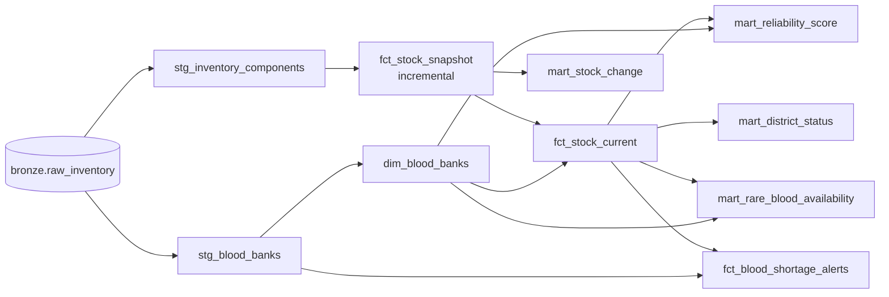

# 06 · dbt Models

**What you will learn**
- What dbt is and how this project sets it up
- Every silver and gold model: its purpose, grain, logic and tests
- How to add, run and test a model

---

## 1. dbt in 60 seconds

- Each `.sql` file in `dbt/models/` is **one table or view**, written as a `SELECT`.
- `{{ ref('model_name') }}` means "read from that other model". dbt uses these references to work out
  the **order** to build things in.
- `{{ source('bronze', 'raw_inventory') }}` means "read the raw table" (declared in `sources.yml`).
- `{{ config(materialized='table') }}` sets what gets created:
  - `view`: saved SQL, run every time it is read;
  - `table`: the result is stored;
  - `incremental`: only new rows are added.
- `schema.yml` holds the **tests** (`not_null`, `unique`, `accepted_values`) and column descriptions.
- **dbt-duckdb** is the adapter that lets dbt talk to a DuckDB file.

### Project setup
- `dbt/dbt_project.yml`: silver models are **views** in schema `silver`, gold models are **tables** in schema `gold`.
- `dbt/profiles.yml`: the target `dev` writes to `BLOODGRID_WAREHOUSE_PATH`, or `blood_warehouse.duckdb` if that is not set.
- The real schema names become `main_silver` and `main_gold` (see [04 §6](04_ARCHITECTURE.md#6-schema-names-you-will-see)).

---

## 2. Lineage (what feeds what)



**Naming:** `stg_` = staging (silver); `dim_` = dimension (describes things); `fct_` = fact
(measurements); `mart_` = a ready-made answer for one feature.

---

## 3. Silver models

### `stg_blood_banks` (view)
- **Purpose:** one clean row per blood bank (the **latest** version of it).
- **Grain:** 1 row per `hospital_code`.
- **Logic:**
  ```sql
  ROW_NUMBER() OVER (
      PARTITION BY hospital_code
      ORDER BY scraped_at DESC, TRY_CAST(entry_date_raw AS TIMESTAMP) DESC NULLS LAST
  ) AS rn
  ...
  WHERE rn = 1
  ```
  Bronze has the same bank once per run. This keeps only the newest copy.
  It also `TRIM`s the text, and `TRY_CAST` turns `entry_date_raw` into `source_updated_at`
  (bad dates become NULL instead of crashing).
  Rows with no code, name or state are dropped.
- **Tests:** `hospital_code` not_null + unique; `hospital_name` and `state_name` not_null.

### `stg_inventory_components` (view)
- **Purpose:** turns the nested components JSON into **one row per bank × component × blood group**.
- **Grain:** run × hospital × component × blood group.
- **Logic, step by step** (each step is a CTE, a named sub-query):

| CTE | What it does | Example |
|-----|--------------|---------|
| `base` | Casts `components_raw` to JSON | `{"Plasma": {...}, "Packed Red Blood Cells": {...}}` |
| `component_keys` | `UNNEST(json_keys(comp_json))` gives one row per component | `Packed Red Blood Cells` |
| `avail_strings` | Pulls out `available_WithQty` | `"A+Ve : 3, O+Ve : 5"` |
| `pairs` | `UNNEST(string_split(avail_str, ','))` gives one row per pair | `"A+Ve : 3"` |
| final | Splits on `:`, normalises the group, casts the units | `A+`, `3` |

  ```sql
  {{ normalize_blood_group("string_split(pair, ':')[1]") }} AS blood_group,
  GREATEST(0, COALESCE(TRY_CAST(TRIM(string_split(pair, ':')[2]) AS INTEGER), 0)) AS units
  ```
  Only **available** groups are read. A group that is missing means 0. `fct_stock_current` handles this.
- **Tests:** not_null on code, component, group and units; `accepted_values` on `blood_group`.

### Macro: `normalize_blood_group`
`dbt/macros/normalize_blood_group.sql` is a big `CASE` that maps every spelling eRaktKosh uses to one
standard label:

| Raw | Standard |
|-----|----------|
| `A+Ve`, `A+VE`, `APOS` | `A+` |
| `AB-Ve`, `ABNEG` | `AB-` |
| `Oh+VE`, `Bombay…OH+` | `Bombay (Oh+)` |
| `Oh-VE` | `Bombay (Oh-)` |

**Order matters:** the macro checks `AB` before `A`, and `OH` before `O`. Otherwise `AB+` would match
`A+…`.

---

## 4. Gold models

### `dim_blood_banks` (table)
- **Purpose:** the master list of blood banks. The API joins to it for name, contact and address.
- **Grain:** 1 row per bank (4,716 at the time of writing).
- **Logic:** selects from `stg_blood_banks` and renames `scraped_at` to `lakehouse_ingested_at`.
- **Tests:** `hospital_code` unique + not_null.
- **Used by:** almost every API endpoint and the anomaly gate.

### `fct_stock_snapshot` (incremental)
- **Purpose:** the **history**: stock per bank, component and group for each scrape day.
- **Grain:** hospital × component × group × `snapshot_date` (this is the `unique_key`).
- **Incremental logic:**
  ```sql
  
      WHERE scraped_at > (SELECT COALESCE(MAX(snapshot_at), '1970-01-01'::TIMESTAMP) FROM {{ this }})
  
  ```
  The first run reads everything. Later runs only add rows newer than what is already stored. If two
  scrapes happen on the same day, the `unique_key` makes the newer one replace the older one.
- **Used by:** `fct_stock_current`, `mart_stock_change`, and the trend chart (`/api/history`).

### `fct_stock_current` (table)
- **Purpose:** the **current** stock. This is what users search.
- **Grain:** hospital × component × group.
- **Logic:**
  1. `ROW_NUMBER()` picks the newest snapshot for each series.
  2. **Important rule:** if a series was **not** in the bank's latest scrape, its units become **0**:
     ```sql
     CASE WHEN r.snapshot_at >= l.latest_at THEN r.units ELSE 0 END AS units
     ```
     Why? eRaktKosh only lists *available* groups. If O- had 3 units yesterday and is missing today, it
     ran out, and we must not keep showing 3.
- **Tests:** not_null on code, component, group and units.

### `mart_reliability_score` (table)
- **Purpose:** the trust score (0–100) for every bank.
- **Formula:** freshness (50) + valid phone (25) + component coverage (25). Worked example in
  [09](09_DOMAIN_LOGIC.md#2-trust-reliability-score).
  ```sql
  CASE WHEN days_since_update <= 1 THEN 50 WHEN <= 3 THEN 35 WHEN <= 6 THEN 20 WHEN <= 13 THEN 8 ELSE 0 END
  CASE WHEN regexp_matches(hospital_contact, '[0-9]{8,}') THEN 25 ELSE 0 END
  CASE WHEN distinct_components_count >= 3 THEN 25 WHEN >= 1 THEN 15 ELSE 0 END
  ```
- **Output:** `reliability_score` and `reliability_label` (High ≥ 75, Medium ≥ 40, Low), plus each part.
  `reliability_tier` is the same as the label and is kept so older code still works.
- The **same formula** is also in Python, in `scoring.py`, for unit tests. If you change one, change both.

### `mart_district_status` (table)
- **Purpose:** supply health per district, for the Shortages table.
- **Grain:** state × district × component × group.
- **Columns:** `total_reporting_banks`, `stocked_banks`, `banks_with_zero`, `total_units`, min/max,
  `shortage_flag` (≤ 5 units), `severity_score` (100/75/40/10), and `shortage_status`
  (`CRITICAL_DEPLETION` / `HIGH_SHORTAGE` / `MODERATE_SHORTAGE` / `ADEQUATE`).

### `mart_rare_blood_availability` (table)
- **Purpose:** where rare blood is in stock right now (Rare Blood Radar).
- **Filter:** groups `Bombay (Oh±)`, `O-`, `A-`, `B-`, `AB-` with `units > 0`.
- **`rarity_tier`:** `ULTRA_RARE_BOMBAY` or `RH_NEGATIVE`. Bombay rows are sorted first.

### `mart_stock_change` (table)
- **Purpose:** trend flags per series.
- **Logic:** `LAG(units, 1/2/3)` looks at the previous 3 snapshots.
  - `delta_prev` = now − previous.
  - `risk_flag` = `Falling` (3 drops in a row), `Depleted` (≤ 2 units) or `Stable`.
  - `anomaly_flag` = `SUDDEN_DROP_TO_ZERO` when stock goes from positive straight to 0.
  - `delta_7d` is only filled when there are at least 7 snapshot dates (the "no fake data" rule).

### `fct_blood_shortage_alerts` (table)
- **Purpose:** one alert row per bank.
- **Columns:**
  - `data_freshness_status`: `CURRENT`, `OUTDATED (>7 days)` or `CRITICALLY STALE (>30 days)`;
  - `stock_alert_level`: `CRITICAL DEPLETION (0 Units)`, `MODERATE DEFICIT REPORTED` (≤ 5) or `NORMAL / NO REPORT`.

---

## 5. Everyday dbt commands

All dbt commands need `--project-dir dbt --profiles-dir dbt` (shortened to `…` below):

| Task | Command |
|------|---------|
| Build everything + run the tests | `uv run dbt build …` |
| Run only one model | `uv run dbt run … --select fct_stock_current` |
| Run a model **and everything after it** | `uv run dbt run … --select fct_stock_current+` |
| Run only the tests | `make dbt-test` |
| Test one model | `uv run dbt test … --select mart_district_status` |
| Rebuild the incremental model from scratch | `uv run dbt run … --select fct_stock_snapshot --full-refresh` |
| See the compiled SQL | Look in `dbt/target/compiled/blood_project/models/...` |
| Generate and view the docs | `make docs` then `make serve-docs` → http://localhost:8080 |

After changing a model, run `make publish` so the website sees the change.

---

## 6. How to add a new model (example)

Goal: the total units per state.

1. Create `dbt/models/gold/mart_state_units.sql`:
   ```sql
   {{ config(materialized='table') }}
   SELECT state_name, blood_group, SUM(units) AS total_units
   FROM {{ ref('fct_stock_current') }}
   WHERE component_name = 'Packed Red Blood Cells'
   GROUP BY state_name, blood_group
   ```
2. Add tests in `dbt/models/gold/schema.yml`:
   ```yaml
     - name: mart_state_units
       columns:
         - name: state_name
           tests: [not_null]
   ```
3. Build it: `uv run dbt build --project-dir dbt --profiles-dir dbt --select mart_state_units`.
4. Publish it: `make publish`.
5. Query it from the API as `main_gold.mart_state_units` (see [08 §6](08_BACKEND_API.md)).

---

Next: [07 · Database →](07_DATABASE.md)
