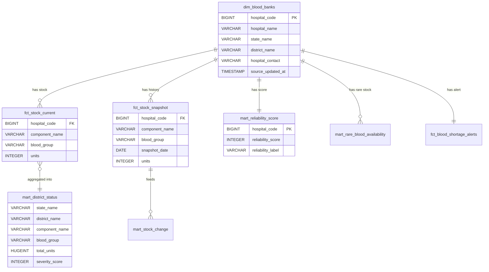

# 07 · Database

**What you will learn**
- The two DuckDB files and what is inside each one
- How the tables relate (ER diagram)
- The data dictionary: every column of every table the app uses
- Ready-to-use SQL for debugging

---

## 1. The files

| File | Written by | Read by | Contains |
|------|-----------|---------|----------|
| `blood_warehouse.duckdb` | the pipeline (`bloodlake …`, dbt) | the pipeline, `make status` | bronze + silver + gold + `gold.pipeline_runs` |
| `serving.duckdb` | `bloodlake publish` (copy) | FastAPI (read-only) | the same content, frozen at the last good run |
| `demo/fallback_lakehouse.duckdb` | you, once | `make demo-offline` | an offline backup copy |

> You may see old tables such as `main_gold.fct_state_blood_summary` or `bronze.raw_blood_inventory`.
> They were left behind by older models that have since been deleted. Nothing uses them. Running
> `DROP TABLE` on them is safe.

---

## 2. Opening the database

**Option 1: from Python (nothing extra to install)**
```bash
uv run python -c "import duckdb; c=duckdb.connect('serving.duckdb', read_only=True); print(c.sql('SHOW ALL TABLES'))"
```

**Option 2: the DuckDB CLI** (install it from https://duckdb.org/docs/installation)
```bash
duckdb -readonly serving.duckdb
D SHOW ALL TABLES;
D DESCRIBE main_gold.fct_stock_current;
D .quit
```

**Option 3: a GUI.** DBeaver can open the `.duckdb` file. **Close it** before running the pipeline,
or you will get a lock error.

> Always open `blood_warehouse.duckdb` with `read_only=True` while the pipeline may be running.

---

## 3. ER diagram



The key that links everything is **`hospital_code`**, eRaktKosh's own ID for each bank.

---

## 4. Data dictionary

### `main_gold.dim_blood_banks`: 1 row per blood bank
| Column | Type | Meaning | Example |
|--------|------|---------|---------|
| hospital_code | BIGINT | eRaktKosh bank ID (**primary key**) | `323` |
| hospital_name | VARCHAR | Name | `Baruipur Sdh` |
| hospital_address | VARCHAR | Full address | `…, South 24 Parganas` |
| hospital_contact | VARCHAR | Raw contact string | `Phone: 94140…, Fax: -, Email: …` |
| hospital_type | VARCHAR | Ownership | `Govt.` / `Private` / `Charitable/Vol` |
| facility_type | VARCHAR | Kind of facility | `Blood Bank` |
| state_name, district_name | VARCHAR | Location | `West Bengal`, `South Twenty Four Parganas` |
| source_updated_at | TIMESTAMP | When **the bank** last updated eRaktKosh (IST) | `2026-10-21 18:12:50` |
| lakehouse_ingested_at | TIMESTAMP | When **we** scraped it | `2026-10-21 18:06:01` |

### `main_gold.fct_stock_current`: 1 row per bank × component × group
| Column | Type | Meaning |
|--------|------|---------|
| hospital_code | BIGINT | → dim_blood_banks |
| hospital_name, state_name, district_name | VARCHAR | Copied over to save joins |
| component_name | VARCHAR | One of 14, e.g. `Packed Red Blood Cells`, `Fresh Frozen Plasma`, `Single Donor Platelet`, `Whole Blood` |
| blood_group | VARCHAR | `A+ A- B+ B- AB+ AB- O+ O- Bombay (Oh+) Bombay (Oh-)` |
| units | INTEGER | Units available now (0 if not in the latest scrape) |
| source_updated_at | TIMESTAMP | The bank's update time |
| last_synced_at | TIMESTAMP | Our scrape time |

### `main_gold.fct_stock_snapshot`: history
The same as above, plus `snapshot_at` (TIMESTAMP) and `snapshot_date` (DATE). There is one row per
series per day.

### `main_gold.mart_reliability_score`
`hospital_code`, bank details, `days_since_update`, `distinct_components_count`,
`total_units_in_stock`, `freshness_points` (0–50), `contact_points` (0/25), `completeness_points`
(0/15/25), **`reliability_score`** (0–100), **`reliability_label`** (High/Medium/Low), `reliability_tier`
(same as the label).

### `main_gold.mart_district_status`
`state_name, district_name, component_name, blood_group, total_reporting_banks, stocked_banks,
banks_with_zero, total_units, min_facility_units, max_facility_units, shortage_flag (BOOL),
severity_score (100/75/40/10), shortage_status`.

### `main_gold.mart_rare_blood_availability`
Bank details + `component_name, blood_group, units, rarity_tier (ULTRA_RARE_BOMBAY | RH_NEGATIVE),
source_updated_at, last_synced_at`.

### `main_gold.mart_stock_change`
`current_units, prev_snapshot_units, delta_prev, delta_7d, risk_flag (Falling|Depleted|Stable),
anomaly_flag (SUDDEN_DROP_TO_ZERO|NORMAL)` for each series.

### `main_gold.fct_blood_shortage_alerts`
`last_updated_at, days_since_last_update, total_units, data_freshness_status, stock_alert_level` per bank.

### `gold.pipeline_runs`
`run_id, started_at, finished_at, status, facilities_count, tests_passed, error_message, created_at`.
See [05 §8](05_DATA_PIPELINE.md#8-run-records-goldpipeline_runs).

### `bronze.raw_inventory`
The landing columns (see [05 §3](05_DATA_PIPELINE.md#3-step-2-landing-immutable-parquet)) +
`ingested_at`. One row per bank **per run**.

> To regenerate this list: `uv run python -c "import duckdb;c=duckdb.connect('serving.duckdb',read_only=True);print(c.sql('DESCRIBE main_gold.fct_stock_current'))"`

---

## 5. Useful debugging queries

```sql
-- How many banks, states and districts?
SELECT COUNT(*), COUNT(DISTINCT state_name), COUNT(DISTINCT district_name) FROM main_gold.dim_blood_banks;

-- When was the last scrape, and how fresh are the banks?
SELECT MAX(lakehouse_ingested_at) AS last_scrape,
       COUNT(*) FILTER (WHERE source_updated_at >= now() - INTERVAL 24 HOUR) AS fresh_24h
FROM main_gold.dim_blood_banks;

-- Everything one bank has right now
SELECT component_name, blood_group, units FROM main_gold.fct_stock_current
WHERE hospital_code = 323 AND units > 0 ORDER BY 1, 2;

-- O- red cells in one district
SELECT hospital_name, units FROM main_gold.fct_stock_current
WHERE district_name = 'Anand' AND blood_group = 'O-' AND component_name = 'Packed Red Blood Cells';

-- Bank history (what the trend chart shows)
SELECT snapshot_date, blood_group, units FROM main_gold.fct_stock_snapshot
WHERE hospital_code = 323 AND component_name = 'Packed Red Blood Cells' ORDER BY 1;

-- Why does a bank have a low trust score?
SELECT reliability_score, freshness_points, contact_points, completeness_points, hospital_contact, days_since_update
FROM main_gold.mart_reliability_score WHERE hospital_code = 323;

-- Unexpected blood group spellings (the macro missed one)
SELECT blood_group, COUNT(*) FROM main_silver.stg_inventory_components GROUP BY 1 ORDER BY 2 DESC;

-- Last 5 pipeline runs
SELECT run_id, status, facilities_count, error_message FROM gold.pipeline_runs ORDER BY started_at DESC LIMIT 5;

-- Which timezone is DuckDB using?
SELECT current_setting('TimeZone');
```

---

Next: [08 · Backend API →](08_BACKEND_API.md)
