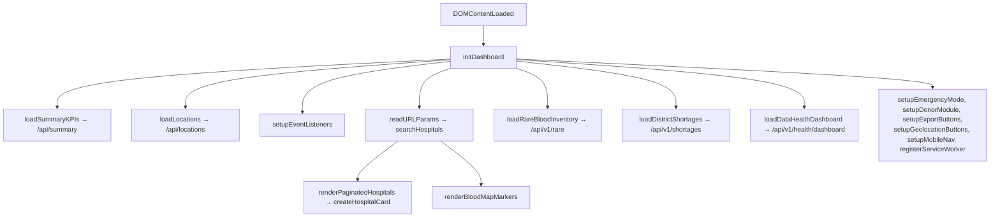

# 10 · Frontend

**What you will learn**
- How `index.html` is organised
- How `app.js` works: state, API calls, rendering and events
- The tricky parts: the race guard, the URL state, the map, location and modals
- Responsive CSS and the PWA (service worker)
- How to add a new section from start to finish

Files:
- [`web/index.html`](../../web/index.html)
- [`web/js/app.js`](../../web/js/app.js) (~1960 lines)
- [`web/css/style.css`](../../web/css/style.css)
- [`web/sw.js`](../../web/sw.js)
- [`web/manifest.json`](../../web/manifest.json)

There is **no build step**. Edit a file, refresh the browser, and you see the change.

---

## 1. `index.html`: the page layout

| Section id | What it is |
|------------|-----------|
| `.app-header` + `#main-nav` + `.nav-toggle` | Sticky top bar; ☰ on screens 1200 px wide or less |
| hero + KPI cards (`#kpi-total-banks`, `#kpi-fresh-banks`, `#kpi-stale-banks`, `#kpi-today-banks`) | Headline numbers |
| `#emergency-section` / `#emergency-call-list-section` | Emergency form / ranked results |
| `#finder-section` | Filters: `#state-select`, `#district-select`, group buttons `.segment-btn`, `#search-input`, `#sort-select` |
| `#results-section` | `#hospitals-grid` (cards), `#map-view-container` (map), `#pagination-wrapper` |
| `#chart-section` | `#statesChart` (Chart.js) |
| `#radar-section` | Rare blood table `#rare-blood-tbody` |
| `#shortages-section` | Shortage filters + `#shortages-tbody` + export buttons |
| `#donor-section` | `#donor-form` eligibility checker |
| `#health-section` | Data Health panel |
| `#about-section` | About and disclaimer |
| `#history-modal`, `#trust-modal` | Pop-up dialogs |

The external libraries are loaded from CDNs, each pinned to a version:
- **Chart.js 4.4.1** (jsDelivr)
- **Leaflet 1.9.4** (unpkg)

---

## 2. `app.js`: how it is organised



### Global state (top of the file)
```js
let locationsMap = {};          // {state: [districts]}
let selectedBloodGroup = "";
let selectedComponent = "Packed Red Blood Cells";
let currentHospitalsData = [];  // the full search result
let currentPage = 1, pageSize = 9;
let userLat = null, userLng = null;   // set by "Near me"
let leafletMap = null, chartInstance = null;
```

### Function groups
| Group | Functions |
|-------|-----------|
| Start-up | `initDashboard`, `setupEventListeners`, `setupMobileNav` |
| KPIs and chart | `loadSummaryKPIs`, `animateCounter`, `renderStatesChart` |
| Finder | `loadLocations`, `searchHospitals`, `renderPaginatedHospitals`, `updatePaginationNav`, `createHospitalCard`, `parseStockGroups`, `resetAllFilters` |
| Map | `initOrUpdateLeafletMap`, `renderBloodMapMarkers` |
| Trend modal | `openHospitalHistory`, `fetchAndRenderHospitalHistory`, `renderHistoryChart`, `renderHistorySummaryTable`, `closeHospitalHistory` |
| Trust modal | `openTrustScoreModal`, `closeTrustScoreModal` |
| Emergency | `setupEmergencyMode`, `populateEmergencyLocations`, `checkEmergencyClinicalWarning`, `searchEmergencyRecommendations` |
| Location | `setupGeolocationButtons`, `requestUserLocation`, `setLocationButtons`, `clearUserLocation` |
| Other sections | `loadRareBloodInventory`, `loadDistrictShortages`, `setupDonorModule`, `evaluateDonorEligibility`, `setupExportButtons`, `loadDataHealthDashboard` |
| Helpers | `extractPrimaryPhone`, `totalUnits`, `escapeHTML`, `escapeQuotes`, `syncURLParams`, `readURLParams` |
| Offline | `setupNetworkAndFreshnessWatchers`, `showGlobalNoticeBanner`, `registerServiceWorker` |

---

## 3. The important patterns

### 3.1 Searching and paging
`searchHospitals()`:
1. Shows 6 grey "skeleton" cards while it loads.
2. Calls `/api/search?...&limit=10000` and gets **all** matches at once.
3. Saves them in `currentHospitalsData`.
4. `renderPaginatedHospitals()` shows 9 at a time. Changing the page needs **no new request**.

### 3.2 The race guard (`searchSeq`)
**The problem:** a user picks "Gujarat" and then quickly "Kerala". The two requests might come back in
the wrong order, and the page would show Gujarat results with Kerala filters.

**The fix:**
```js
let searchSeq = 0;
async function searchHospitals() {
    const seq = ++searchSeq;          // this call's ticket number
    ...
    const data = await res.json();
    if (seq !== searchSeq) return;    // a newer search has started → drop this result
```

### 3.3 Filters saved in the URL
- `syncURLParams()` writes `?state=..&district=..&component=..&blood_group=..` with `history.replaceState`
  (the page does not reload).
- `readURLParams()` reads them back at start-up, so a shared link opens the same search.

### 3.4 Safe HTML
Data from the API is put into HTML with `escapeHTML()`. If a hospital name contained `<script>`, it
would be shown as plain text and never run. This blocks **XSS** (cross-site scripting).

### 3.5 The map (Leaflet + CARTO)
```js
leafletMap = L.map('blood-map', { center: [22.2587, 71.1924], zoom: 7 });
L.tileLayer(`https://{s}.basemaps.cartocdn.com/rastertiles/light_all/{z}/{x}/{y}{r}.png?key=${cartoApiKey}`, ...)
```
- **CARTO needs an API key.** Without it, every tile shows "API KEY REQUIRED". The key is a public,
  browser-side key, so it is fine for it to be in the JS.
- The map is drawn only when you open the map view (`#toggle-map-btn`). Leaflet needs a visible
  container to measure its size.
- `renderBloodMapMarkers()` adds one pin per bank, adds a blue `.user-dot` if a location is set, and
  calls `fitBounds` so every pin is in view.

### 3.6 Location ("Near me")
```js
if (!window.isSecureContext) { alert('Location only works on a secure page (https:// or localhost)...'); return; }
navigator.geolocation.getCurrentPosition(success, error, { enableHighAccuracy: true, timeout: 10000 });
```
- On success, it saves `userLat`/`userLng`, sets the sort to **distance**, and searches again.
- Pressing the button a second time **turns location off** (`clearUserLocation`).
- Emergency mode with a location tries `radius_km` = 50, then 150, then 400 until it finds results.

### 3.7 Modals
- Opening a modal remembers the focused element (`lastFocusedElement`) and stops the page behind it
  from scrolling (`body.style.overflow='hidden'`).
- Closing it (the ✕ button, a click outside, or **Esc**) restores both.

### 3.8 Offline and stale banners
- **Offline:** `setupNetworkAndFreshnessWatchers()` listens for the browser's `online` and `offline`
  events and checks `navigator.onLine` at start-up. It shows `#global-stale-banner` while you are offline.
- **Stale data:** `loadDataHealthDashboard()` shows `#stale-sync-banner` when the API reports
  `is_stale_warning`, which means the last sync was more than 12 h ago.

---

## 4. Responsive CSS

The breakpoints are near the end of `style.css`:

| Media query | What changes |
|-------------|-------------|
| `max-width: 1200px` | The nav becomes the ☰ hamburger menu |
| `max-width: 1024px` / `900px` / `768px` | Grids go from 3 columns to 2 |
| `max-width: 640px` | 1 column, smaller headings, filters stack |
| `max-width: 480px` | Tighter padding, the blood group buttons wrap |
| `max-width: 360px` | Very small phones |
| `pointer: coarse` | Touch screens: buttons at least **40 px** high, so they are easy to tap |
| `prefers-reduced-motion` | Turns animations off for users who asked for that |

Useful tricks used:
- `grid-template-columns: repeat(auto-fill, minmax(min(280px, 100%), 1fr))`: cards never get wider
  than the screen.
- `html { scroll-padding-top: 84px }`: when you jump to a section, the sticky header does not cover its title.

**Check a layout:** open Chrome DevTools, press the device toolbar button (Ctrl+Shift+M), and try
widths of 360, 390, 768 and 1366. In the Console, `document.documentElement.scrollWidth` should equal
`innerWidth` (no sideways scrolling).

---

## 5. PWA

### `manifest.json`
It holds the app name, the icons (`/assets/icon-192.svg`, `icon-512.svg`), the theme colour and
`display: standalone`. Together these make "Add to Home screen" open the site like an app.

### `sw.js`: the service worker
```js
const CACHE_NAME = 'raktsetu-shell-v5';
const DATA_CACHE_NAME = 'raktsetu-data-v5';
```
| Event | What it does |
|-------|--------------|
| `install` | Saves the app shell (`/`, `style.css`, `app.js`, `manifest.json`, icons) in the cache |
| `activate` | Deletes old caches (any name that isn't v5) |
| `fetch` `/api/*` | **Network-first.** A 200 answer is saved in the data cache. When offline, it returns the cached answer, or `503 {"error":"offline"}` |
| `fetch` other | **Network-first.** It caches the shell files and the CDN libraries, **but not map tiles** (there are too many) |

**When you change `app.js` or `style.css`:** network-first means online users get the new files
automatically. If you change the **service worker logic**, raise the version (`v5` → `v6`) so old
caches are cleared.

**Debug it:** DevTools → Application → Service Workers (tick "Update on reload") and Cache Storage.

---

## 6. How to add a new section end to end

Example: a "State units" table using the endpoint from [08 §6](08_BACKEND_API.md#6-how-to-add-a-new-endpoint).

**1. HTML** (in `index.html`, before `#donor-section`):
```html
<section id="state-units-section" class="section">
  <h2>Units by State</h2>
  <table><tbody id="state-units-tbody"></tbody></table>
</section>
```
**2. Nav link:** `<a href="#state-units-section">States</a>` inside `#main-nav`.

**3. JS** (in `app.js`):
```js
async function loadStateUnits() {
    const tbody = document.getElementById('state-units-tbody');
    try {
        const res = await fetch('/api/v1/state-units?blood_group=O-');
        const rows = await res.json();
        tbody.innerHTML = rows.map(r =>
            `<tr><td>${escapeHTML(r.state)}</td><td>${r.units}</td></tr>`).join('');
    } catch (e) {
        tbody.innerHTML = '<tr><td colspan="2">Could not load data.</td></tr>';
    }
}
```
Then call `loadStateUnits()` inside `initDashboard()`.

**4. CSS:** reuse the existing table classes, then check the layout at 360 px.

**5. Test:** add a check to the Playwright script (see [11](11_TESTING.md)).

---

Next: [11 · Testing →](11_TESTING.md)
